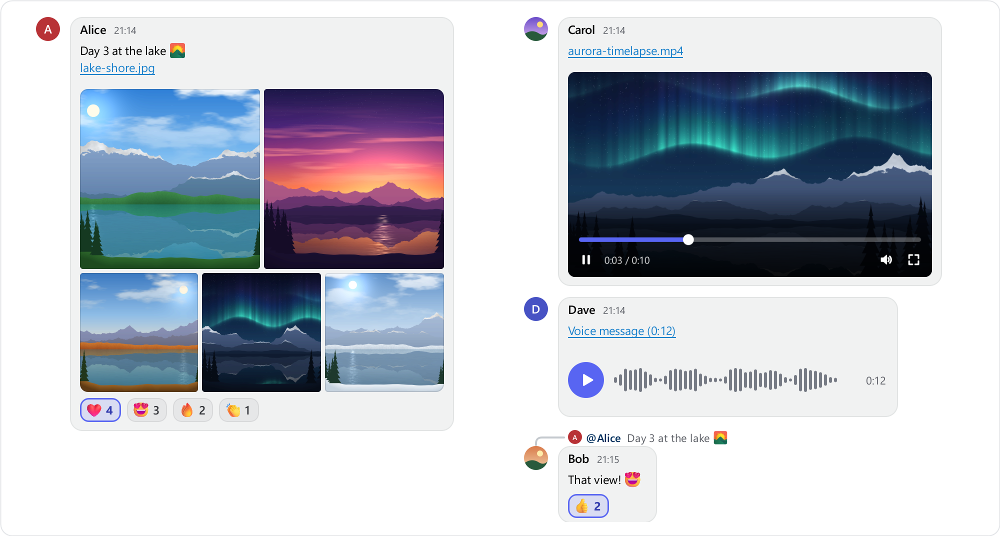
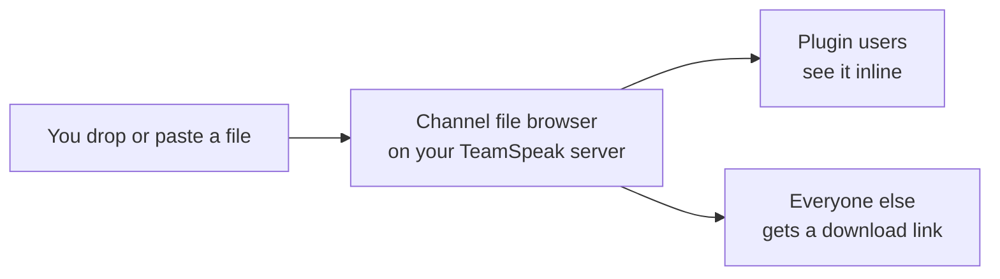
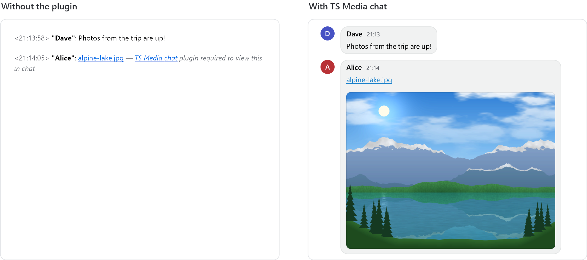
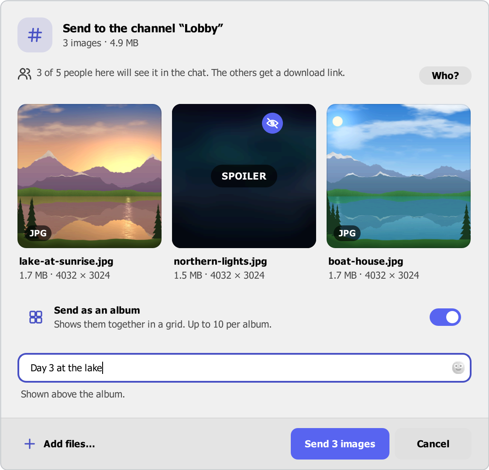
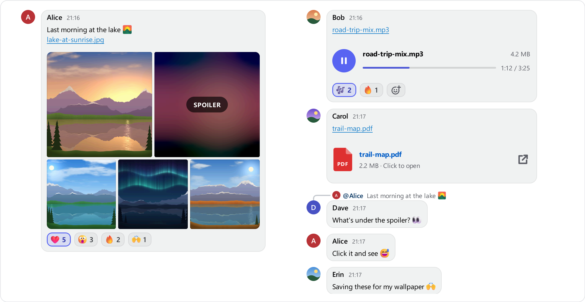
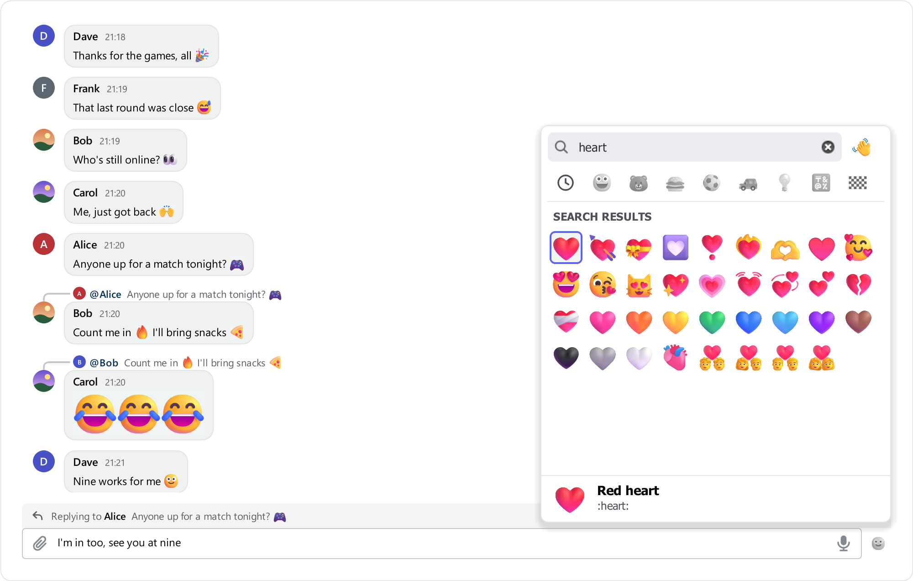
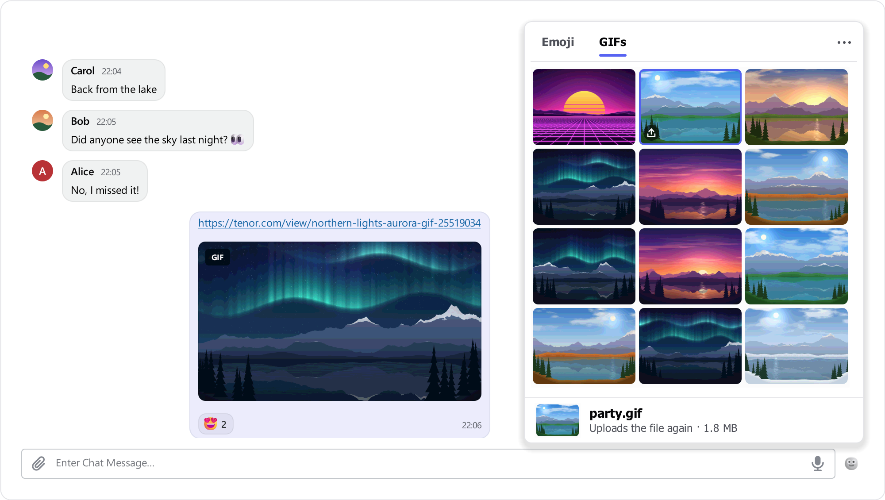
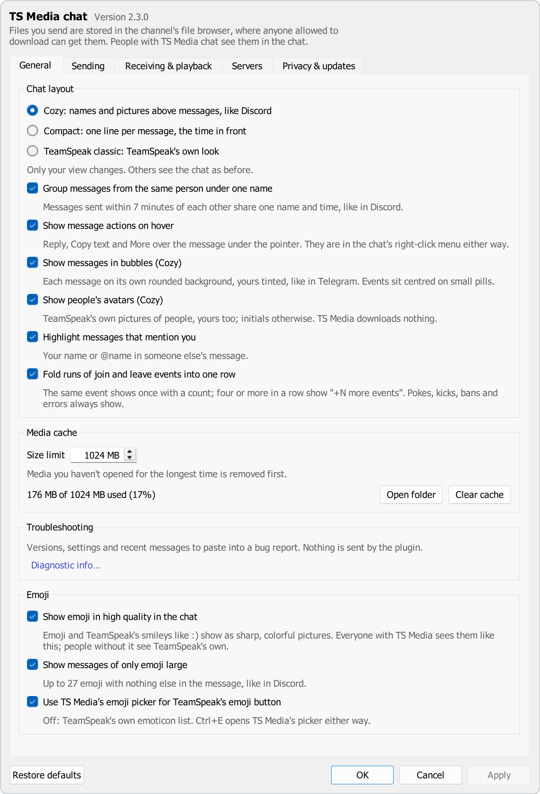

# TS Media chat

**Discord-style images, GIFs, videos, voice messages, polls, live music, link previews, replies and HD emoji in the TeamSpeak 3 chat**

For TeamSpeak 3.6.x on Windows 10 and 11 · Free to use · Not for TeamSpeak 5 or 6

No cloud · No telemetry · Files stay on your TeamSpeak server

[Install](#install) · [User guide](docs/USAGE.md) · [Server admins](#server-admin-guide) · [FAQ](docs/FAQ.md) · [Changelog](CHANGELOG.md)

<picture>
  <source media="(prefers-color-scheme: dark)" srcset="docs/images/hero-dark.png">
  
</picture>

**TS Media chat** is a plugin for the TeamSpeak 3 client on Windows. Drop a file on the chat, paste a screenshot or record a voice message, and everyone with the plugin sees it right in the chat.

## Why TS Media chat

- **Send anything.** Drag & drop, paste with Ctrl+V or use the paperclip in the chat input, with a caption, spoilers or as an album.
- **Hold to talk.** Hold the microphone in the chat input to record a voice message; let go to send it.
- **Anonymous polls.** Ask the channel, vote on the card, see the results; nobody sees who voted for what.
- **Live music.** Play a song to your channel through your own voice and keep talking over it.
- **See and play it inline.** Photos, GIFs, album grids, videos, audio and voice messages, right in the chat.
- **Link previews.** YouTube links show their title, channel and thumbnail and play in a small player window over TeamSpeak; links to pictures, GIFs and videos, and to GIF and media sites like Tenor, Giphy, Imgur or Klipy (clips, stickers, memes), show and play inline; well-known sites (Vimeo, Spotify, X, GitHub, Wikipedia, …) and other web pages get a card like Discord's. Previews of links people with the plugin send come from your TeamSpeak server, so your PC never contacts that website. Other links load from their website by themselves; you can switch that to click-to-load.
- **A modern chat.** Names, avatars and times above grouped messages, Telegram-like bubbles with yours on the right, and centred system lines, only in your own view.
- **Reply and react.** Reply to any message, Discord-style, and react to any message or media with any emoji.
- **HD emoji.** Sharp Windows 11 emoji in the chat, TeamSpeak's own emoji button opening an HD picker, and big emoji for messages of only emoji.
- **Your GIFs, one click away.** The picker's GIFs tab keeps the GIFs you send (Giphy, Tenor, Klipy, Imgur and other GIF sites, GIF links and GIF files you upload), like Telegram; *Save to GIFs* keeps any other. Stored only on your PC.
- **Browse every item.** A gallery viewer with zoom, a full video player and keyboard shortcuts.
- **Works for everyone.** People without the plugin get a normal TeamSpeak download link.
- **Stays on your server.** Files go to the channel's file browser, never to a cloud service.
- **Keeps itself up to date.** If you agree, updates from GitHub install with one click, every file checked against its SHA-256. Important fixes signed by the author install by themselves and start with your next TeamSpeak start.

## Install

1. Download **`TSMedia-<version>.ts3_plugin`** from the [latest release](https://github.com/Metihttp/Teamspeak_Media_chat/releases/latest).
2. Close TeamSpeak, then double-click the file. TeamSpeak's own installer opens and shows the author **MehdiHttp**: that is this project (GitHub [@Metihttp](https://github.com/Metihttp)). Click **Install**, and answer **Yes** when it asks whether to activate the add-on.
3. Start TeamSpeak again and type `/tsmedia` in the chat. The plugin replies with its version and commands.

If nothing happens, enable the plugin in **Tools → Options → Addons**.

**Requirements:** TeamSpeak 3 Client 3.6.x on Windows 10 or 11; TeamSpeak 5 and 6 are not supported. The package contains a 64-bit and a 32-bit DLL; the 32-bit one is untested. Your server group needs file transfer permissions ([server admin guide](#server-admin-guide)). H.264 videos (most .mp4 files) play out of the box; other formats may need a video extension from the Microsoft Store ([FAQ](docs/FAQ.md#a-video-doesnt-play)).

<b>Updates, uninstall and portable installs</b>

- **Updates:** from 2.2.0 on, the plugin asks once whether to check GitHub for updates, then asks before installing each one; from 2.4.0 on, important fixes signed by the author install without asking and start with the next TeamSpeak start ([how updates work](docs/UPDATES.md)). From 2.1 or older, install the latest version by hand once: close TeamSpeak, double-click the new `.ts3_plugin`. Settings and the cache are kept.
- **Uninstall:** use **Tools → Options → Addons**, or close TeamSpeak and delete `tsmedia_win64.dll` and `tsmedia_win32.dll` from `%APPDATA%\TS3Client\plugins`; delete the `tsmedia` folder there to remove the settings, cache and log too. Sent files stay on the servers.
- **Portable TeamSpeak:** uses the `config` folder inside the TeamSpeak folder instead of `%APPDATA%\TS3Client`.

## How it works

The file is uploaded with TeamSpeak's own file transfer into the channel you are in, and an ordinary TeamSpeak file link is posted. People with the plugin see the media in its place. People without it see the link and a short grey note, *TS Media chat plugin required to view this in chat*, that links to this page.

<picture>
  <source media="(prefers-color-scheme: dark)" srcset="docs/images/with-without-dark.png">
  
</picture>

## Send files

Drop files on the chat, press <kbd>Ctrl</kbd>+<kbd>V</kbd> in the chat input, click the **paperclip** at its left end (**Photo or video** or **Document**), or use **Plugins → TS Media chat → Send files to chat…** (also `/tsmedia send` and a hotkey). The send window opens; nothing is sent until you click **Send**. Hold <kbd>Ctrl</kbd> while dropping to send right away, or <kbd>Shift</kbd> for TeamSpeak's own drop.

  

- **Caption** (up to 300 characters), **Mark as spoiler** per item, and **Send as an album** for 2 to 10 pictures and videos.
- **Edit…** crops a picture, draws on it and pixelates or blacks out details. Edited copies are sent without photo metadata; unedited photos are sent as they are.
- **Quality:** videos over 25 MB become a 720p MP4 on your computer before the upload. *Original* sends the file as it is.
- **Who will see it:** *3 of 5 people here will see it in the chat. The others get a download link.*

The file is stored in the channel you are in; the message goes to the chat tab you are looking at. More in the [user guide](docs/USAGE.md#sending-files).

## View media

- **Photos and GIFs** up to 15 MB load automatically; larger ones when you click them.
- **Albums** show as one grid. **Spoilers** stay blurred until clicked.
- **Videos and audio files** play inline. Other files appear as cards that open in their default app.
- **Reactions with any emoji:** click the round button on a picture, or right-click → **Add reaction**; **+** opens the emoji picker. Text messages, links, replies and polls get them too (point at the message → **Add reaction**, or right-click → **Add reaction…**).
- **Checked downloads:** a file that differs from the one that was sent is blocked (*File doesn't match what was sent*).
- **Link previews:** YouTube cards, pictures, GIFs and videos under their web links (also from GIF and media sites), and cards for well-known sites and other web pages ([below](#link-previews)).
- **Sharp at any size:** previews follow the chat's text, so they grow with Windows display scaling (200% on a 4K screen), with Ctrl + mouse wheel over the chat and with TeamSpeak's chat font. **Preview size** (Small, Normal, Large, Larger) makes them smaller or larger than the text.

<picture>
  <source media="(prefers-color-scheme: dark)" srcset="docs/images/album-dark.png">
  
</picture>

Clicking a photo opens the **gallery viewer**. Right-click a preview for Save as…, Copy file and more, or drag it out into a folder ([right-click menu and shortcuts](docs/USAGE.md#right-click-menu)).

## Link previews

<picture>
  <source media="(prefers-color-scheme: dark)" srcset="docs/images/link-previews-dark.png">
  
</picture>

- **YouTube** links get a card with the title, channel and thumbnail. Play shows the video with YouTube's own player in a small window of its own over TeamSpeak (privacy-enhanced mode, nothing loaded before you press Play; 64-bit TeamSpeak only, the 32-bit one opens your browser; turn it off to always open your browser); the title and the channel name open the video in your browser.
- **Links to pictures, GIFs and videos** show the file right in the chat, like one sent with TS Media: the gallery viewer, animated GIFs, inline video.
- **GIF and media sites** (Tenor, Giphy, Imgur, Klipy, Reddit, Streamable, Imgflip, Pinterest, 9GAG and more): the GIF or video itself, GIF-like videos playing silently in a loop. Klipy's clips, stickers and memes work. Klipy's GIF pages (`klipy.com/gifs/…`) are behind Klipy's own bot check for apps that don't run a browser; TS Media then asks Klipy's public oEmbed for the GIF, whose answer doesn't name it yet, so they get no preview for now and start working by themselves once Klipy fixes that answer.
- **Cards** for well-known sites (Vimeo, SoundCloud, Spotify, Apple Music, Dailymotion, X, Bluesky, Twitch, Kick, Steam, GitHub, Wikipedia, Telegram, Discord invites, Reddit) and for other web pages: site, title, a short text and a picture; a click opens the link in your browser. Turn the other web pages off on their own with **Show cards for other web pages**.
- **Nextcloud and ownCloud** share links show the picture, GIF or video itself; other files and folders get a small card with the name, type and size. Only servers on the public internet: links to a server on a LAN, a VPN or a private address are never loaded.
- **Made by the sender:** when someone with TS Media sends such a link in a channel or private chat, their plugin loads it once and puts the preview in the channel's files. You see it from your TeamSpeak server and never contact that website.
- **Your own links** show their preview at once from your own download (*Making the preview…* until then).
- **Other links** (from people without the plugin) load their preview from the website by themselves when they show on your screen, which shows that website your IP address: cards always, pictures, GIFs and videos within your automatic download limit (15 MB by default; videos use your video limit if you set one). Larger files get a **Load preview** card with their size. Cards for other web pages show nothing while they load or when they fail: right-click the message → **Load link previews** loads (or retries) them by hand. Turn off **Load link previews automatically** to load them only when you click (**Load preview**, or **Load link previews** in a message's menu).
- On by default: turn them off in **Settings → Privacy & updates**, or right-click one → **Hide preview**. Previews use your Windows proxy if you have one ([more about link previews](docs/USAGE.md#link-previews)).

## Voice messages

<picture>
  <source media="(prefers-color-scheme: dark)" srcset="docs/images/voice-dark.png">
  
</picture>

Press and hold the **microphone** at the right end of the chat input: recording starts at once, and a strip above the input shows the time and a live waveform. Let go and it is sent. To cancel, move the pointer away from the microphone before you let go (or press <kbd>Esc</kbd>). With the keyboard, **Plugins → TS Media chat → Record voice message…** or `/tsmedia voice` opens a small window with **Send** and **Cancel**. Up to 5 minutes; your TeamSpeak microphone is muted while you record, so voice activation doesn't send you live. [More about voice messages](docs/USAGE.md#voice-messages).

## Polls and live music

<picture>
  <source media="(prefers-color-scheme: dark)" srcset="docs/images/polls-music-dark.png">
  
</picture>

- **Polls:** paperclip → **Poll**, type a question and 2 to 10 answers. Everyone with the plugin votes on the poll card and sees the percentages, the counts and the total once they voted; people without it read the poll as text. Votes are anonymous ballots: nobody, not even the poll's author, can see who voted for what ([how polls work](docs/POLLS.md)).
- **Live music:** paperclip → **Live music** (or `/tsmedia music`), then pick a file. It plays to your channel through your own voice, so everyone hears it, with or without the plugin, and you can keep talking. A slim bar above the chat input pauses, seeks, sets the volume and stops; on another server tab it stays, compact, and the music pauses until you come back. Channels set to Opus Music sound best ([more about live music](docs/USAGE.md#live-music)).

## Chat layout

<picture>
  <source media="(prefers-color-scheme: dark)" srcset="docs/images/chat-layout-dark.png">
  
</picture>

TeamSpeak's chat gets a modern look in your own view: names, avatars and times above the messages, messages of one person grouped, each message in its own bubble like Telegram (yours on the right, tinted, with their time), day dividers, and join or leave lines as small centred rows with an icon (runs of them fold into *+N more events*). Point at a message for **Add reaction**, **Reply**, **Copy text** and **More**; messages that mention you are highlighted. Choose *Cozy* (the default), *Compact* (one line per message) or *TeamSpeak classic* in **Settings → General → Chat layout**. Nobody else sees a difference.

## Replies and emoji

- **Reply:** right-click a message → **Reply**, or press <kbd>Alt</kbd>+<kbd>↑</kbd> in the chat input (again for older messages). A bar above the input shows what you are replying to; <kbd>Enter</kbd> sends, <kbd>Esc</kbd> cancels.
- With the plugin, a reply shows a small reply line above it; click it to jump to the original. Right-click the original → **View 2 replies** lists the answers.
- Without the plugin (or on 2.1), people see an italic quote line, *↪ Alice · 21∶14: “the start of her message…”*, followed by the reply.
- **HD emoji:** emoji and TeamSpeak's smileys in messages show as sharp, colorful pictures, and emoji in reply lines too; a message of only emoji shows them large. Open the picker with TeamSpeak's own emoticon button or <kbd>Ctrl</kbd>+<kbd>E</kbd>.
- **GIFs tab:** the picker's **GIFs** page shows the GIFs you sent, newest first; a click sends one again (a GIF file is uploaded again). Right-click a GIF in the chat → **Save to GIFs** to keep it; nothing is sent anywhere and opening the tab contacts no website ([GIFs](docs/USAGE.md#gifs)).

<picture>
  <source media="(prefers-color-scheme: dark)" srcset="docs/images/replies-emoji-dark.png">
  
</picture>

<picture>
  <source media="(prefers-color-scheme: dark)" srcset="docs/images/gifs-dark.png">
  
</picture>

More in the user guide: [replies](docs/USAGE.md#replies) and [emoji](docs/USAGE.md#emoji).

## Settings

  

Open them with **Plugins → TS Media chat → Settings…** or `/tsmedia settings`. Most changed:

- **Chat layout:** *Cozy*, *Compact* or *TeamSpeak classic*.
- **Download images, GIFs and voice messages automatically up to** (15 MB). Videos and audio download when played.
- **Data saver:** pause automatic downloads everywhere, or on one server.
- **When you drop files on the chat:** *Open the send window* or *Send right away*.
- **Compress videos larger than** (on, 25 MB).

All options: [settings reference](docs/SETTINGS.md).

## Server admin guide

The plugin uses TeamSpeak's own file transfer. **If a user can upload and download files in a channel with the file browser, the plugin works for them.** Nothing has to be installed on the server, only permissions.

**One-click group:** as a server admin, open **Settings → Servers → Server access** and click **Create TS Media chat group**. It creates a `tsmediachat` server group with an icon and the file permissions. Then right-click a user → **TS Media chat → Give TS Media chat access**.

**By hand**, grant these in **Permissions → Server Groups → File Transfer**:

| Permission | Needed for | Rule |
| --- | --- | --- |
| `i_ft_file_upload_power` | sending (uploading) | at least the channel's `i_ft_needed_file_upload_power` |
| `i_ft_file_download_power` | seeing media inline, downloading | at least the channel's `i_ft_needed_file_download_power` |
| `i_ft_directory_create_power` | creating `/tsmedia` and `/tsmedia/previews` | at least the channel's `i_ft_needed_directory_create_power`; without it, files go to the channel root |

> [!WARNING]
> On a default TeamSpeak server, the **Guest** server group cannot upload. New users can't send anything until they get the `tsmediachat` group or `i_ft_file_upload_power`.

Password-protected channels are not supported, and clients must reach the file transfer port (TCP 30033 by default). The [full server admin guide](docs/SERVER-ADMIN.md) covers the group's permissions, ServerQuery, quotas and housekeeping.

## Privacy & security

- **Your files stay on your TeamSpeak server.** No cloud, no telemetry.
- **Web requests: the update check, link previews and the YouTube player.** The update check goes to GitHub, automatically only after you turn it on. **Link previews** (on by default, switches in **Settings → Privacy & updates → Link previews**): when you send a YouTube link or a link to a picture, GIF or video (and since 2.5 any web page) in a channel or private chat, your PC loads it once from that website and puts the preview in the channel's files; people with TS Media then see it from your TeamSpeak server and never contact the website. With **Load link previews automatically** on (the default), a link from someone without the plugin is loaded from its website by your PC, which sees your IP address; turn it off to load such links only when you click **Load preview**. Previews go through your Windows proxy if one is set. Web pages are read only up to the end of their head (a Kick clip's page: its first 512 KB; a Nextcloud or ownCloud share page: until the part that says what the share is, at most 512 KB) and never shown or run. [Details](docs/PRIVACY-SECURITY.md#link-previews).
- **The YouTube player connects only after you press Play.** Then your PC connects to YouTube and Google (and WebView2 to Microsoft), as in a browser; it plays in a private profile, and *Play YouTube videos in the chat* off opens videos in your browser instead. [Details](docs/PRIVACY-SECURITY.md#playing-youtube-videos).
- **Your channel sees that you have TS Media** (and its version), and your reactions. Both go through TeamSpeak only and can be turned off in **Settings → Privacy & updates**.
- **A reply quotes the original:** its author's name and the start of the message, readable by everyone in that chat.
- **The microphone is only on** while you hold the microphone button, or while the *Voice message* window shows *Recording*.
- **Channel members can open what you send.** Files stay until someone deletes them.
- **Received programs are never run**, only shown in Explorer.
- **Chat links are treated as untrusted.** Sizes, previews, names and checksums are checked.

The DLL is not code-signed; every update file is checked against the SHA-256 listed in the GitHub release. All details: [privacy & security](docs/PRIVACY-SECURITY.md).

## Troubleshooting

<b>TeamSpeak shows "Bad Image" with error status <code>0xc0000020</code></b>

Windows considers the plugin DLL damaged, usually by an antivirus product or an incomplete download. Close TeamSpeak and reinstall a fresh download. If it happens again, add an antivirus exclusion for `%APPDATA%\TS3Client\plugins`.

<b>Dropping files opens a window instead of sending</b>

That is the send window, new in 2.2. Hold <kbd>Ctrl</kbd> while dropping to send right away, or choose *Send right away* in **Settings → Sending → When you drop files on the chat**.

<b>A video doesn't play</b>

H.264 (most .mp4 files) works out of the box. HEVC, VP9 and AV1 need the matching extension from the Microsoft Store, and Windows N editions need the Media Feature Pack. [Details in the FAQ](docs/FAQ.md#a-video-doesnt-play).

More answers in the [FAQ](docs/FAQ.md).

## Build from source

You need Visual Studio 2022 Build Tools, Qt 5.15.2, Git and Python 3; one script builds the package. Copies you build yourself never update themselves. See [building from source](docs/BUILDING.md) and the [architecture overview](docs/ARCHITECTURE.md).

## Support and feedback

Found a bug? Check the [FAQ](docs/FAQ.md), then [open a bug report](https://github.com/Metihttp/Teamspeak_Media_chat/issues/new?template=bug_report.yml). Type `/tsmedia diag` in the chat and press *Copy* to get the versions, settings and recent plugin messages for its *Diagnostic info* box (file names are left out unless you include them).

Ideas, suggestions or questions? Message me on Telegram: [@metii](https://t.me/metii).

## License and credits

Copyright (c) 2026 MehdiHttp. All rights reserved.

This project is **not open source** and comes with no open-source license. The source code is published for transparency and reference. You are welcome to install and use the official releases, but copying, modifying or redistributing the code or the built files requires the author's permission (apart from what GitHub's Terms of Service allow, such as viewing and forking on GitHub).

- Author: **MehdiHttp** (GitHub [@Metihttp](https://github.com/Metihttp), Telegram [@metii](https://t.me/metii))
- [BlurHash](https://github.com/woltapp/blurhash) by Wolt (MIT License), ported in `src/blurhash.cpp`.
- [TeamSpeak 3 Client Plugin SDK](https://github.com/teamspeak/ts3client-pluginsdk), copyright TeamSpeak Systems GmbH, included as a git submodule and not covered by this project's copyright.
- Qt 5.15 (The Qt Company), loaded from the TeamSpeak installation at runtime; Windows Media Foundation (Microsoft) for video, audio and voice messages.
- Microsoft Edge WebView2 SDK loader (Microsoft, BSD-style license, reproduced in [THIRD-PARTY-NOTICES](docs/THIRD-PARTY-NOTICES.md)), linked into the YouTube player helper; the WebView2 Runtime is part of Windows.
- TeamSpeak is a trademark of TeamSpeak Systems GmbH; Discord is a trademark of Discord Inc. This project is not affiliated with or endorsed by either of them.
