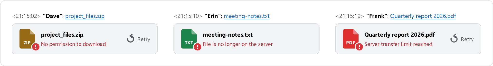

# FAQ and troubleshooting

[← Back to README](../README.md)

Answers to common questions, grouped by topic. Each question has its own link, so you can share it.

- [Install and updates](#install-and-updates)
- [Sending](#sending)
- [Viewing and playback](#viewing-and-playback)
- [Reactions and presence](#reactions-and-presence)
- [Replies and emoji](#replies-and-emoji)
- [Voice messages](#voice-messages)
- [Polls and live music](#polls-and-live-music)
- [Permissions](#permissions)
- [Compatibility](#compatibility)
- [Storage](#storage)

## Install and updates

### TeamSpeak shows "Bad Image" with error status `0xc0000020`

Windows considers the plugin DLL damaged. Usually an antivirus product quarantined or modified it, or the download was incomplete. Close TeamSpeak, download the package again from the [releases page](https://github.com/Metihttp/Teamspeak_Media_chat/releases/latest) and reinstall it. If it happens again, add an exclusion for `%APPDATA%\TS3Client\plugins` in your antivirus. The DLL is not code-signed, so some antivirus heuristics may flag it.

### The plugin doesn't show up in TeamSpeak

Check that you run TeamSpeak 3.6.x and that the plugin is enabled in **Tools → Options → Addons**. The TeamSpeak log (`%APPDATA%\TS3Client\logs`) should contain a line like `TS Media chat 2.5.0 loaded`.

### How do I update?

From 2.2.0 on, the plugin can update itself. About 45 seconds after its first start it asks *Keep TS Media chat up to date?*; click **Turn on**. It then checks GitHub about once a day and shows *Update to X?* with what's new. **Update** downloads and checks the new version, and **Restart TeamSpeak now** finishes it. You can also check at any time with **Plugins → TS Media chat → Check for updates…** or `/tsmedia update`. From 2.4.0 on, important fixes install by themselves (see the next questions).

Coming from 2.1 or older, install the latest version by hand once: download the new `.ts3_plugin`, close TeamSpeak completely (the old DLL is locked while TeamSpeak runs), double-click the file and start TeamSpeak again. Your settings and the cache are kept. The same works for any later version.

### Why did TS Media chat update by itself?

It was an important update. From 2.4.0 on, with automatic checks on, a release the author marked as important and signed with the release key is downloaded and installed without a click; the chat then says *TS Media chat X is an important update and was installed automatically.* It starts the next time you open TeamSpeak: TeamSpeak is never restarted for it. To start it now, use **Plugins → TS Media chat → Check for updates…**, which offers **Restart TeamSpeak now**. A version that rolled back on your PC, or that you replaced by hand with an older one, is never installed by itself again. Don't want this? Turn off **Settings → Privacy & updates → Check for updates automatically**; then nothing is checked or installed by itself. Details: [important updates](UPDATES.md#important-updates).

### The chat says "Someone in this channel has TS Media chat X"

Someone in your channel has a newer TS Media chat than you (2.4.0 and later show this). Only you see that line, and nothing is sent until you click **Check for updates**, which checks GitHub once, like **Check now**. Anyone can claim any version, so if GitHub doesn't have it, the chat says *TS Media chat X isn't released yet. You have the latest release (Y).*: it may be a test version or made up. At most 2 such lines appear per TeamSpeak session. [More](UPDATES.md#someone-in-this-channel-has-a-newer-version).

### Is the update check safe? What does it send?

It asks the plugin's GitHub releases for one small file (two when automatic checks find a newer version: the second says whether it is an important update), and nothing is installed unless you click **Update** and every downloaded file matches the SHA-256 listed in that release. The exception is an important update with automatic checks on: it installs without a click, but only with the author's signature for exactly that release, and its files must match the signed SHA-256. GitHub sees your IP address; no names, servers, chats or files are sent. It is off until you agree, and you can turn it off in **Settings → Privacy & updates → Updates**. Copies you build yourself have no update check. Details: [updates](UPDATES.md).

### An update went wrong

Every error says what happened and whether anything was changed. If the new version crashes while starting, its second start puts the previous version back by itself and tells you in the chat. If TeamSpeak doesn't start at all, start it once with `-safemode` or install any release by hand. See [if something goes wrong](UPDATES.md#if-something-goes-wrong).

### TeamSpeak crashes or hangs when I quit

On some PCs TeamSpeak 3 crashes when you quit it, or its window closes but `ts3client_win64.exe` keeps running in the background, so TeamSpeak won't start again. This happens in TeamSpeak's own sound backend, also without TS Media chat, and depends on the sound device and its driver. What helps:

1. In **Tools → Options → Playback** and **Tools → Options → Capture**, switch *Playback Mode* and *Capture Mode* to the other one: from *Windows Audio Session* to *DirectSound*, or back.
2. Update the driver or app of your headset or sound device.
3. If TeamSpeak still runs in the background, open Task Manager (<kbd>Ctrl</kbd>+<kbd>Shift</kbd>+<kbd>Esc</kbd>), end `ts3client_win64.exe` (`ts3client_win32.exe` on 32-bit TeamSpeak) under **Details**, then start TeamSpeak again.

Before 2.2.1, quitting while the plugin's *Voice message* window was open could also leave TeamSpeak running without a window; 2.2.1 fixes that.

### Does it work with 32-bit TeamSpeak?

The package includes a 32-bit DLL, but it hasn't been tested on a real 32-bit client yet. If you try it, please report the result in the [issues](https://github.com/Metihttp/Teamspeak_Media_chat/issues).

## Sending

### Dropping files opens a window instead of sending them

Since 2.2, a drop opens the send window, where you can add a caption, mark spoilers and send an album. Hold <kbd>Ctrl</kbd> while dropping to send right away, or set **Settings → Sending → When you drop files on the chat** to *Send right away*. Hold <kbd>Shift</kbd> for TeamSpeak's own drop.

### I don't want Ctrl+V or dropping files to send anything

Both can be turned off in **Settings → Sending**. For a single drop, hold <kbd>Shift</kbd> while dropping.

### My video was compressed. How do I send the original?

Videos over 25 MB, and iPhone (HEVC), AV1, VP9 and camcorder videos, are converted to an MP4 (720p by default) before the upload, so they upload faster and play everywhere. To send one as it is, pick *Original* in its **Quality** list in the send window, or click **Send original** in the upload panel while it compresses. To change the size, the quality or turn it off: **Settings → Sending → Videos**.

### "This file is larger than your 100 MB upload limit"

Raise *Upload size limit* in **Settings → Sending** (up to 4096 MB), or for one server in **Settings → Servers**. The server's transfer quotas still apply. For videos, the send window picks a smaller quality that fits when it can.

### The send window says only some people will see it in the chat

The line counts the people in your channel whose TS Media chat answered. People on TS Media 2.1 or older can't answer yet, so they count as getting a link even though they see the media; the count grows as friends update. People who turned off *Tell people in your channel that you have TS Media* aren't counted either.

### Some people see my spoiler unblurred

People on TS Media 2.1 or older, and people without the plugin, can't blur it; the send window says so under *Mark as spoiler*. People with 2.2 or later who turned on *Show spoilers without blurring* see spoilers right away by their own choice.

### My caption appeared as its own message

A caption that doesn't fit in the same chat message as the file (long file names, very long captions) is sent as its own message right above the file. It is never shortened.

### TeamSpeak disconnects me right after I send a file

That was a bug in 2.3.2 on TeaSpeak servers (the log says `Disconnected from server, no autoreconnect: parameter not found`). Update to 2.3.3 or later: **Check for updates…** in the plugin menu. The file you sent is in the channel's file browser; send it again once you have updated.

### Files end up in the channel root instead of `/tsmedia`

Your server group doesn't have `i_ft_directory_create_power`, so the plugin can't create the folder. Ask your server admin, or see the [server admin guide](SERVER-ADMIN.md#permissions).

### I can't send files in a password-protected channel

Sending files and voice messages to password-protected channels isn't supported. Use another channel.

### Nothing happens when I send in a private chat

If the plugin can't tell who the private chat is with (for example, they left the server), it sends nothing and says so in the chat. This makes sure something meant for one person never ends up in the channel.

### The upload panel says "TeamSpeak is limiting messages. Retrying…"

TeamSpeak's flood protection asked the plugin to slow down, usually after many files or messages in a short time. The plugin waits and sends the message again by itself; nothing is lost.

## Viewing and playback

### A video doesn't play

Inside the chat, a video that Windows can't play shows *Opens in default app* and opens in your default video app when you click it. The gallery viewer names the missing decoder and offers **Get it from Microsoft Store** when there is an extension for it. H.264 (most .mp4 files) works out of the box. For the others, install the matching extension from the Microsoft Store:

| Format | Extension to install |
| --- | --- |
| HEVC (H.265) | HEVC Video Extensions |
| VP9 (many .webm files) | VP9 Video Extensions |
| AV1 | AV1 Video Extension |
| MPEG-2 | MPEG-2 Video Extension |

Windows N editions (for example Windows 11 Pro N) need the **Media Feature Pack**. Formats Windows can't decode at all (ProRes, DNxHD, …) can still be opened with right-click → *Open in default app*. Since 2.2, senders convert hard-to-play videos to H.264 before uploading, so this gets rarer as people update.

### An audio file doesn't play

Ogg and Opus files need **Web Media Extensions** from the Microsoft Store; the card or the viewer says so. A file Windows can't play shows *Can't play here · Click to open in your default app*.

### Pictures don't load by themselves any more

Data saver is probably on, for all servers (**Settings → Receiving & playback**) or for this server (**Settings → Servers**, or **Plugins → TS Media chat → Resume automatic downloads on this server**). Held items say *Data saver — click to load*. Spoilers also wait until you reveal them.

### GIFs only play when I point at them

Either *Play GIFs automatically* is off in **Settings → Receiving & playback**, or Windows animations are turned off (**Settings → Accessibility → Visual effects → Animation effects**). The plugin follows that Windows setting: GIFs then play only while the pointer is over them, and loading indicators stand still.

### Previews look small on my 4K screen

Since 2.5, previews follow the chat's text: at 150% or 200% display scaling they are drawn larger and sharp, in proportion to TeamSpeak's own text (before, cards and their text stayed at their 100% size). Zooming the chat with Ctrl + mouse wheel, or a larger chat font in TeamSpeak (**Options → Chat**), makes them grow too. If they are still too small or too large for you, change **Preview size** under **Settings → Receiving & playback** (Small, Normal, Large, Larger). *Maximum preview size* is the largest picture at Normal size and 100% scaling.

### Pictures look smaller at 100% in the viewer

Since 2.1.0, 100% in the gallery viewer shows one image pixel per screen pixel. On a display scaled to 125%, 150% or more, that is smaller than in apps that scale pictures up. *Fit* still fits the picture into the window, but never enlarges it.

### Other people don't see my images in the chat

They need the plugin too, and download permission in that channel. Without the plugin they see the link and the note, and can click the link to download the file.

### A preview says "Not connected to this server"

The file is on a server you are not connected to, for example after a disconnect. Reconnect and click the preview. Downloads interrupted by a lost connection resume by themselves once you are back.

### "File doesn't match what was sent"

The downloaded file is different from the one the sender posted, twice in a row: it was most likely replaced or damaged on the server. TS Media chat deletes it and never shows or saves it, and there is no way to open it anyway. Click the preview to try once more, or ask the sender to send it again. Right-click → **Copy details** copies both checksums and the file's path if you want to report it.

Since 2.3.2 a download that came out different (or too short) because the sender's upload was still arriving at the server waits for the upload instead (*Waiting for the sender's upload…*) and downloads the file again once the server has all of it, and senders with 2.3.2 post their message only once the server has the whole file.

On TeaSpeak servers an upload that is still arriving already has its full size, with zeros where the rest will go. Senders with 2.3.2 or later therefore also read the end of the file back from the server (on every server; it costs a download of about 64 KB) and compare it with what they uploaded before posting (since 2.3.3 that is all they do on TeaSpeak: asking TeaSpeak for a file's size disconnects TeamSpeak), and receivers treat a download that ends in zeros as an upload still arriving, not as a different file. If the sender's upload never completes, the preview says *Download failed* (the file never arrived completely) with **Retry**, instead of *File doesn't match what was sent*.

### What do the messages on a preview mean?

<picture>
  <source media="(prefers-color-scheme: dark)" srcset="images/errors-dark.png">
  
</picture>

When a download fails or waits, the preview or card says why:

| Message | What it means | What to do |
| --- | --- | --- |
| No permission to download | Your server group may not download files in this channel. | Ask a server admin ([permissions](#no-permission-to-download)). |
| File is no longer on the server | The file was deleted from the server, or replaced after it was sent. | Ask the sender to send it again. |
| File doesn't match what was sent | The file on the server is not the one that was sent. | Click to try again, or ask the sender to send it again. |
| Checking file… | The download is being compared with its checksum. | Wait a moment. |
| Waiting for the sender's upload… | The sender's upload is still arriving at the server; the file is downloaded again once it is all there. | Wait a moment. |
| Channel is password protected | The file is stored in a password-protected channel. | Use TeamSpeak's file browser. |
| Not connected to this server | You are not connected to the server the file is on. | Reconnect; the download resumes. |
| Server transfer limit reached | The server's file transfer quota is used up. | Ask a server admin. |
| Data saver — click to load | Data saver holds automatic downloads. | Click it, or turn data saver off. |
| Download failed | Something else went wrong. | Click the preview to try again. |
| Can't preview this image | The image is too large to decode (above 80 megapixels) or can't be read. | Click it, then choose **Open with default app**. |

Deleted files and files in password-protected channels can't be retried: their previews do nothing when clicked. For everything else, including files that don't match, click the picture or the card's **Retry** button to try again. Point at a card to read the whole message.

### I came from BetterChat: does TS Media show YouTube and GIF links?

Yes, since 2.4. YouTube links get a card with the title, channel and thumbnail (since 2.5 Play plays the video with YouTube's own player in a small window over TeamSpeak; the title opens it in your browser), and links to pictures, GIFs and videos show and play right in the chat, like files sent with TS Media. The difference to BetterChat: when the sender has TS Media, their plugin makes the preview once and shares it through your TeamSpeak server, so your PC never contacts that website. Links from people without TS Media load from the website by themselves (like BetterChat); turn off **Load link previews automatically** to load them only when you click. Since 2.5, GIF sites' pages (Tenor, Giphy, Imgur, Klipy and others) show the GIF itself, and other pages get a card, like in Discord. Klipy's GIF pages (`klipy.com/gifs/…`) are behind Klipy's own bot check for every app that doesn't run a browser; TS Media then asks Klipy's public oEmbed for the GIF, whose answer doesn't name it yet, so they get no preview for now and start working by themselves once Klipy fixes that answer. Klipy's clips, stickers and memes work, and so does the GIF's own address. See [link previews](USAGE.md#link-previews).

### How do I turn link previews off?

**Settings → Privacy & updates → Show previews for links to other websites**: no card, no preview and no website request any more. To stop sharing previews of the links you send, turn off **Make previews for links I send**. To keep them but load other people's links only when you click, turn off **Load link previews automatically**. To keep media and site cards but drop cards for other web pages, turn off **Show cards for other web pages**; links shaped like a Nextcloud or ownCloud share (`…/s/…`) are still loaded, to learn whether they hold a picture, GIF or video. To hide just one, right-click it → **Hide preview**.

### Link previews say "Couldn't load the preview" (VPN, proxy, filtered internet)

The plugin couldn't reach that website; its log (`%APPDATA%\TS3Client\plugins\tsmedia\logs\tsmedia.log`) has the reason. If you reach YouTube only through a VPN or proxy app, set it to use the **system proxy** (most proxy-based VPN apps have this option): link previews go through the proxy Windows is set to use, including a setup script or automatic detection. A VPN that works without a proxy setting needs nothing. Previews made by the sender come from your TeamSpeak server and don't need the website at all.

### A link shows "Load preview" instead of the picture

Either **Load link previews automatically** is off, or the file is larger than your automatic download limit (the card shows its size, or that it is over your limit), or data saver is on, or it is waiting its turn (links load 2 at a time, one per person, and a few per person in a row), or **Clear cache** removed the preview its sender had shared. Click **Load preview** to load it from the website yourself; that connects your PC to that website. If the sender's preview arrives later, the card switches to it by itself.

### A link says "Waiting for the sender's preview…"

The sender has TS Media and shares a preview through your TeamSpeak server, so your PC doesn't contact the website. It usually takes a few seconds. Their plugin makes one preview at a time, so it can take up to two minutes for a video, or up to four minutes when they posted several links in a row. *Checking for the sender's preview…* means your PC is still asking whether they make previews (a few seconds). If their plugin can't make it, or they leave, your PC loads the link itself (with **Load link previews automatically** on).

### A link has no card

Cards need a page that tells its title and a short text or picture. Pages behind a bot check, a cookie or sign-in page, or that only work with scripts (TikTok, many shops) give none, and some links are never loaded on purpose (sign-in and download links, documents, TikTok, IMDb, Amazon, Google Maps, and Deezer, whose pictures can't be loaded). Other web pages also need **Show cards for other web pages**. A card that failed, or a page the sender's plugin found nothing on, can be tried by hand: right-click the message, **Load link previews**.

### My Nextcloud link shows no preview

Only shares on servers on the public internet get one: links to a server on a LAN, a VPN or a private address are never loaded. Password-protected and upload-only shares get no preview, and from a link to the share page, shares whose owner turned downloads off or set a download limit are never downloaded (a folder or another file then gets a card, a picture with downloads off its server's preview); a link straight to the file (`…/download/<name>`, `…/dav/…`, a preview address) loads like any other file link and counts as a download. A card for a folder or another file needs **Show cards for other web pages**. A video over your automatic limit shows **Load preview**. Share links with a custom name longer than the usual 15 letters and digits are read as ordinary web pages, and very old Nextcloud versions whose share page is larger than 512 KB get an ordinary web card. Links to one-time download pages (transfer.sh-like tools) can be used up when a preview loads them.

### A card says "Site busy"

The website asked TS Media to wait (HTTP 429). The plugin leaves it alone for as long as it asks and then loads the card by itself. Imgur often answers like this to VPN and datacenter addresses.

### Why does a YouTube video open in my browser?

Since 2.5, Play on a YouTube card plays the video with YouTube's own player, in a small window of its own over TeamSpeak. It opens your browser instead when:

- *Play YouTube videos in the chat* is off (*Settings → Privacy & updates*), or you chose **Open in browser** when the card asked the first time;
- this PC doesn't have the Microsoft Edge WebView2 Runtime (part of Windows 11 and of current Windows 10; the setting's hint says so);
- the video's owner doesn't allow it to be played outside YouTube (the card says *This video can only be watched on YouTube*), or it was removed;
- you use 32-bit TeamSpeak (2.5.0's player needs 64-bit TeamSpeak);
- an antivirus blocked TS Media's player helper (`tsmedia_player_win64_<number>.dll` in TS Media's plugin folder); TS Media then opens the browser for the rest of the session and writes it to its log;
- the player failed to start three times in a session.

### Does playing a YouTube video tell others?

No. Nothing about it is sent to the chat or the TeamSpeak server; only YouTube and Google see that your PC plays it ([details](PRIVACY-SECURITY.md#playing-youtube-videos)).

### YouTube plays on my speakers, not on my TeamSpeak headset

YouTube's player plays on Windows' default output device, not on TeamSpeak's playback device. Change the default device in Windows, or play the video in your browser.

### What does the YouTube player store on my PC?

WebView2's own data, in `%LOCALAPPDATA%\TSMedia\webview2` (`webview2-elevated` while TeamSpeak runs as administrator; no cookies or history: the player is private). Delete that folder to remove it (close TeamSpeak first, or wait a minute after the last video); turning *Play YouTube videos in the chat* off deletes both. The player helper itself is in TS Media's plugin folder (`player`).

### Which websites does a link preview contact?

Only what that kind of link needs: a file link: that file's address; YouTube: `www.youtube.com` and `i.ytimg.com`; GIF and media sites: the site's media address, and for some of them first the page, its official oEmbed address or a short link; a Klipy GIF page behind its bot check: Klipy's public oEmbed at `api.klipy.com`, then the GIF only from Klipy's own `static…klipy.com` servers; well-known sites: the page or the site's official oEmbed or public API address, then the picture on that site's own servers; Nextcloud and ownCloud share links (`…/s/…`): the share page on that server, then the file or the server's own preview of a picture on the same server; other web pages (with *Show cards for other web pages* on): the beginning of the page itself (at most 512 KB, never shown or run), then the picture the page names, which can be on another website. No scripts, cookies, logins or `Referer`. When the sender's TS Media made the preview, nobody else contacts the website. Details: [link previews](PRIVACY-SECURITY.md#link-previews).

## Reactions and presence

### Others don't see my reactions

Reactions reach people with TS Media chat 2.2 or later who are online in the same channel or private chat; reactions on text messages, links, replies and polls need 2.3 on both sides. People on 2.1 or older and people without the plugin don't see them. Someone who comes in later sees the reactions of the people who are still there. Check that *Show reactions* is on in **Settings → Privacy & updates**, and that you are connected. If a reaction couldn't be sent, it is taken back and its tooltip says why (for example *This server doesn't allow plugin messages*).

### Why can't I react in the server chat?

Reactions are only for channel and private chats. In the server chat there are no reaction rows and no *Add reaction*.

### Can I hide that I use TS Media chat?

Yes: turn off **Settings → Privacy & updates → Tell people in your channel that you have TS Media**. The plugin then says goodbye to the people it told, and your send window no longer counts who will see your media. You still see media and can send it as before. Polls send nothing but the votes you cast: your plugin doesn't ask the channel for earlier votes or answer others who ask, so you may not see votes cast before you joined.

## Replies and emoji

### TeamSpeak's emoticon button opens a different list

With TS Media, TeamSpeak's own emoticon button next to the chat input shows an HD face and opens the TS Media chat emoji picker (HD emoji, search, recently used). To get TeamSpeak's own emoticon list back, turn off **Settings → General → Emoji → Use TS Media's emoji picker for TeamSpeak's emoji button**; <kbd>Ctrl</kbd>+<kbd>E</kbd> in the chat input still opens TS Media's picker.

### The chat looks different from my friends' TeamSpeak

That is the chat layout (**Settings → General → Chat layout**): *Cozy* and *Compact* change only your own view, and your messages reach everyone as before. Choose *TeamSpeak classic* for TeamSpeak's own look.

### Where are my GIFs kept, and how do I clear them?

The emoji picker's GIFs tab keeps its list, small pictures and copies of GIF files in `%APPDATA%\TS3Client\plugins\tsmedia\gifs` on your PC (nothing of it is sent anywhere). *Clear cache* doesn't touch it. Remove one GIF with a right-click on it in the GIFs tab → **Remove**, or all of them with **Remove all GIFs…** in the tab's ⋯ menu or in **Settings → General → Emoji**. To stop keeping the GIFs you send, turn off **Remember GIFs I send** there. Uninstalling the plugin leaves the folder like the rest of the plugin's data.

### Why does resending a GIF file upload it again?

A GIF *file* (one you uploaded, or saved from someone else's upload) is sent again like any file: TS Media uploads it to your current channel's file browser again, with the usual progress, limits and checks, and posts its link. TeamSpeak has no way to re-share a file that is already on the server without asking the server about it, which TS Media never does on servers where that is unsafe. So every resend is a new file on the server and counts against its space. GIF *links* (Giphy, Tenor, …) are only sent as their link.

### A smiley like `:)` shows as text in a reply line

In the message itself, TeamSpeak's smileys (`:)`, `;)`, `:D` …) show as HD emoji. In the reply line above a reply, the reply bar, the send window's *Replying to* line and *View replies*, they stay text for now. Real emoji show in HD there too.

## Voice messages

### What do the messages in the Voice message window mean?

| Message | Cause | What to do |
| --- | --- | --- |
| Microphone access is blocked | Windows' privacy setting keeps desktop apps (TeamSpeak too) away from the microphone. | **Open Windows settings**, turn on *Let desktop apps access your microphone*, then try again. |
| No microphone found | Windows has no microphone that is on. | Connect one, or pick one in **Open sound settings**. |
| The microphone is busy | Another app uses the microphone in exclusive mode. | Close that app (or turn off *Allow applications to take exclusive control* for the device), then **Try again**. |
| The microphone was disconnected | It was unplugged or turned off. With 1 second or more recorded, the window keeps what you said. | **Send** what was recorded, or reconnect it and **Try again**. |
| Recording stopped | The *Voice message* window was hidden or minimized, which stops the microphone; or, while you held the microphone button, TeamSpeak never saw you let go (<kbd>Alt</kbd>+<kbd>Tab</kbd>, a menu or another window took the mouse), or another chat came up, so nothing was sent by itself. What you said is kept. | **Send** it, or close the window to discard it. |
| Reached the 5:00 limit | You held the microphone button with the pointer away from it, ready to cancel, when the recording reached 5 minutes, so it wasn't sent by itself. | **Send** it, or close the window to discard it. |
| Not connected to this server | The connection was lost before the message went out. It is kept while the window is open. | Reconnect, then **Send**. |
| This microphone can't be used | Its audio format isn't 44.1 or 48 kHz, which Windows' encoder needs. | Choose another microphone in TeamSpeak (**Tools → Options → Capture**), or set the device to 48000 Hz in **Open sound settings**. |
| Voice messages aren't available | Windows Media Foundation is missing (Windows N editions). | Install the Media Feature Pack. |
| Couldn't save the recording | The file couldn't be written (disk full?). Your recording is kept while the window is open. | Free some space, then **Try again**. |
| No sound from the microphone | Nothing louder than -50 dB arrived for 3 seconds: the microphone may be muted in Windows or on the headset. | Unmute it; the recording goes on meanwhile. |
| Recording from Windows' default communications microphone | The plugin couldn't tell which microphone TeamSpeak uses (or TeamSpeak uses *Default*). | If that's the wrong one, pick yours in TeamSpeak (**Tools → Options → Capture**), or make it Windows' default communications device. |

### I clicked the microphone and nothing was recorded

The microphone button records while you hold it, like in Telegram: press it, talk, and let go to send. A click shorter than half a second records nothing; the strip above the chat input then says *Hold to record, release to send*. If holding a mouse button is hard for you, use **Plugins → TS Media chat → Record voice message…** or `/tsmedia voice`: they record in a window with **Send** and **Cancel** buttons, and work with the keyboard.

### How do I cancel a voice message I'm holding?

Move the pointer away from the microphone before you let go. The strip turns red and says *Release to cancel*; letting go there discards the recording, and nothing is sent. Changed your mind? Move back to the microphone and let go there to send it. <kbd>Esc</kbd> while you hold the button cancels too.

### Others saw my microphone as muted

That's on purpose: while you record, your TeamSpeak microphone is muted so voice activation doesn't send you live to the channel. It is unmuted as soon as the recording stops. If TeamSpeak lost the connection meanwhile, it stays muted for that server until TeamSpeak is connected there again, then the plugin unmutes it (if TeamSpeak is closed before that, unmute it with TeamSpeak's mute button).

### Does the plugin listen all the time?

No. The microphone is only opened while you hold the microphone button in the chat input (a strip above the input shows the time and a red dot) or while the *Voice message* window shows *Recording*; letting go, or closing the window, stops it. Windows' microphone icon in the taskbar shows TeamSpeak as using it during that time (the plugin runs inside TeamSpeak).

### How long can a voice message be?

Up to 5 minutes; the time turns red at 4:30, and at 5:00 it is sent by itself (if you hold the microphone button with the pointer moved away to cancel, it is kept in the *Voice message* window instead). A minute takes about 0.73 MB on the server.

## Polls and live music

### The live music sounds thin or muffled

TeamSpeak sends the music with the channel's voice codec, like your voice. Channels set to **Opus Music** sound best; *Opus Voice*, Speex and CELT are made for speech, and the music bar mentions it when the music starts. Ask a channel admin to set the codec to Opus Music (channel settings → *Audio*), with a high quality.

### I use push-to-talk and the channel can't hear me over the music

With push-to-talk the plugin keeps your TeamSpeak input open while the music plays and sends only the music: it can't see your push-to-talk key, so it never sends your microphone without it. Switch to voice activation (**Tools → Options → Capture**) to talk over the music, or pause the music while you talk.

### Nobody hears the music

The music bar says why on its second line: your microphone or sound is muted in TeamSpeak, TeamSpeak has no microphone open on that server, or you have no talk power in the channel. Muting the music in the bar (or volume 0) stops sending it too. While you're on another server tab the music pauses, because TeamSpeak only sends from the server tab in front; it plays on when you go back to its tab, and play in the compact bar takes you there.

### My vote didn't count / the counts differ between people

A vote reaches people with TS Media 2.3 who are in the poll's channel. If it couldn't be sent, the card says *Your vote didn't reach the others* with **Retry**. Someone who comes in later gets the counts from those present after a moment. Votes are only taken in the channel the poll was posted in; elsewhere the card says so.

## Permissions

### "No permission to download"

Your server group lacks the file transfer permissions (`i_ft_file_download_power`). Show the [server admin guide](SERVER-ADMIN.md) to your server admin.

### "You don't have permission to upload files in this channel"

Your server group lacks `i_ft_file_upload_power`. On a default TeamSpeak server the Guest group cannot upload, so new users hit this first. A server admin can create the `tsmediachat` group with one click and give it to you ([one-click group](SERVER-ADMIN.md#one-click-ts-media-chat-group)), or grant the permission by hand ([granting permissions](SERVER-ADMIN.md#granting-permissions-in-the-teamspeak-client)).

### How do I give someone access as a server admin?

Create the group once in **Settings → Servers → Server access → Create TS Media chat group**, then right-click the person and choose **TS Media chat → Give TS Media chat access** (or **Server Groups → tsmediachat**). See the [server admin guide](SERVER-ADMIN.md#one-click-ts-media-chat-group).

## Compatibility

### What do friends on TS Media 2.1 or older see?

Your files, captions and albums still reach them: they see the caption, every picture of an album as its own preview, spoilers unblurred and voice messages as an ordinary audio file card. A reply reaches them as an italic quote line (*↪ Alice · 21∶14: “…”*) followed by the reply, and emoji look the way TeamSpeak draws them. They don't see or send reactions and don't count as having TS Media in your send window. Once they install 2.2 or later by hand, later versions reach them through the update check.

### What do friends on TS Media 2.2 see?

Everything you send, with reactions on media. A poll reaches them as text (the question, the numbered answers and a link), so they can't vote on it, and they don't see reactions on text messages. Bubbles, centred system lines and avatars are only your own view anyway. Live music reaches everyone in the channel, with or without the plugin. 2.2 updates itself to 2.3 through the update check.

### Does it work with TeamSpeak 5 or TeamSpeak 6?

No. They don't load TeamSpeak 3 plugins. The plugin is made for TeamSpeak 3.6.x.

### macOS or Linux?

No, the plugin is Windows only.

## Storage

### The cache takes too much space

Lower the *Size limit* or click **Clear cache** in **Settings → General → Media cache**. Media still in the chat is downloaded again when needed.

### Where are my settings, the cache and the log?

In `%APPDATA%\TS3Client\plugins\tsmedia`: `settings.ini`, the `cache` folder and `logs\tsmedia.log`. Type `/tsmedia cache` to open the cache folder. A portable TeamSpeak uses the `config` folder inside the TeamSpeak folder instead of `%APPDATA%\TS3Client`. What each file holds: [privacy & security](PRIVACY-SECURITY.md#what-stays-on-your-computer).
