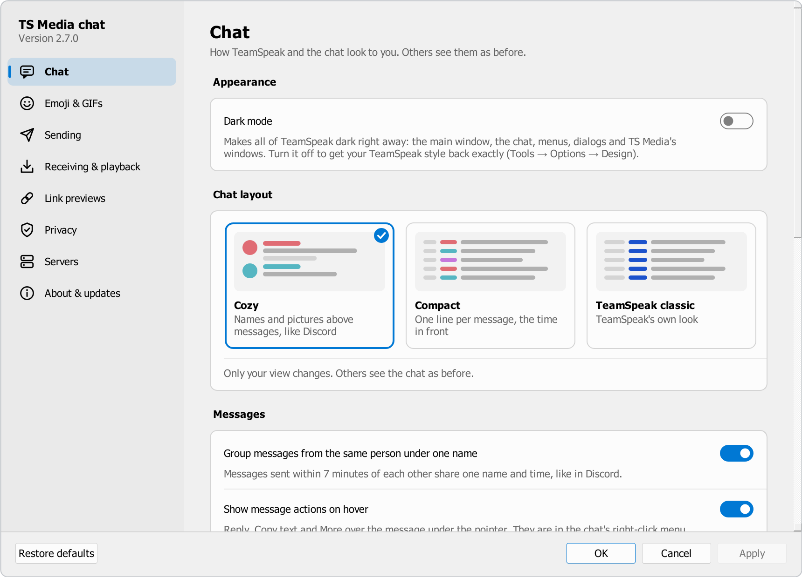

# Settings

[← Back to README](../README.md)

Every option of TS Media chat, with its default and its range.

  <picture>
    <source media="(prefers-color-scheme: dark)" srcset="images/settings-dark.png">
    
  </picture>

Open the settings with **Plugins → TS Media chat → Settings…**, by typing `/tsmedia settings` in the chat, or with the plugin's Settings button in **Tools → Options → Addons**.

| Page | Cards |
| --- | --- |
| [Chat](#chat-page) | Appearance (*Dark mode*), Chat layout, Messages, Text size and colors |
| [Emoji & GIFs](#emoji--gifs-page) | Emoji, GIFs |
| [Sending](#sending-page) | Sending, Dropping files, Videos, Note for people without the plugin |
| [Receiving & playback](#receiving--playback-page) | Receiving (with data saver), Preview size, Playback, Spoilers, Media cache |
| [Link previews](#link-previews-page) | Link previews (with *Only from friends*) |
| [Privacy](#privacy-page) | Privacy (reactions and presence), Chat proxy |
| [Servers](#servers-page) | Servers (settings for single servers), Server access (for server admins) |
| [About & updates](#about--updates-page) | Updates, Troubleshooting (*Diagnostic info…*) |

2.7 rebuilt the window: the pages sit in a sidebar, each page is a column of cards, and on/off options are switches. No setting, default or key changed; only the places did (the 2.6 *General* tab is now the Chat page, and its Emoji, Media cache and Diagnostic info moved to Emoji & GIFs, Receiving & playback and About & updates; *Privacy & updates* became Privacy, Link previews and About & updates).

- Click a page in the sidebar, or use <kbd>↑</kbd> and <kbd>↓</kbd> there; <kbd>Ctrl</kbd>+<kbd>Tab</kbd> or <kbd>Ctrl</kbd>+<kbd>PgDn</kbd> and <kbd>Ctrl</kbd>+<kbd>Shift</kbd>+<kbd>Tab</kbd> or <kbd>Ctrl</kbd>+<kbd>PgUp</kbd> switch pages from anywhere in the window. The dialog opens on the page you used last. Every page scrolls on its own; the window keeps its size when you switch pages.
- **OK** saves and closes, **Apply** saves and keeps the dialog open, **Cancel** closes without saving. While something isn't saved yet, *Not saved yet: OK or Apply saves your changes.* shows next to the buttons (switches here wait for **OK** or **Apply** like everything else, except [*Dark mode*](#appearance), which acts at once). Closing the window with <kbd>Esc</kbd> or its **X** while something isn't saved asks *Save your changes?*: **Save** (as **OK**), **Discard** or **Cancel** (back to the window).
- **Restore defaults** only fills in the default of every option; nothing is saved until you click **OK** or **Apply**. It never touches your update choice, a skipped version, the settings of single servers, the [chat proxy](#chat-proxy), anything done in *Server access*, the [chat text size](#text-size-and-colors) or [dark mode](#appearance).
- Only the options you changed are saved. The volume you set in the gallery viewer and the chat text size you set with Ctrl + mouse wheel are kept, and the dialog follows them.
- Options that only matter when another one is on are indented under it and greyed out (their value kept) while it is off.
- The window follows TeamSpeak's font size: at 200% display scaling everything in it is twice as large, and it opens at most 92% of your screen. Every option has an access key (the underlined letter with <kbd>Alt</kbd>), the focus shows a ring once you use the keyboard, and the colours come from your TeamSpeak skin or, while it is on, from [dark mode](#appearance).

Settings are stored in `%APPDATA%\TS3Client\plugins\tsmedia\settings.ini` (a portable TeamSpeak uses the `config` folder inside the TeamSpeak folder instead of `%APPDATA%\TS3Client`). A value outside its range is corrected to the nearest allowed value when the plugin starts.

Voice messages have no settings since 2.2.1: they always record from TeamSpeak's own microphone, mute your TeamSpeak microphone while you record and play a short sound when recording starts and stops. See [voice messages](USAGE.md#voice-messages).

## Chat page

*How TeamSpeak and the chat look to you. Others see them as before.*

### Appearance

New in 2.7.

| Setting | Default | Range and notes |
| --- | --- | --- |
| Dark mode | off | All of TeamSpeak in a warm dark theme at once, no restart: the main window, the channel tree, the chat and the info panel, menus, tool bars, tool tips, scroll bars, TeamSpeak's dialogs (Options, Connect, Bookmarks, Identities, Permissions, …), the title bars of TeamSpeak's windows and every TS Media window. Chat lines that were already there are made readable on the dark chat. Acts at once, like the chat text size: **OK**, **Apply**, **Cancel** and **Restore defaults** don't change it. Also in the Plugins menu (**Turn on dark mode** / **Turn off dark mode**) and as a hotkey (**Tools → Options → Hotkeys**, *Turn dark mode on or off*). Turning it off (or turning TS Media off while it is on) brings your TeamSpeak style back exactly: the lines in your chats get their colors and text style back (lines that came in while it was on get your style's; kinds of lines dark mode shows alike get one color your style gives their group), TS Media's own lines too, and pictures and cards are drawn in your style's colors at once ([details](FAQ.md#dark-mode-and-my-own-teamspeak-skin)). Your choice in **Tools → Options → Design** is kept; if you pick another style there while dark mode is on, dark mode stays on and that style is the one you get back when you turn it off (one rare exception: [a style made of another style's files and its dark-mode files](FAQ.md#a-style-made-of-another-styles-files-and-its-dark-mode-files)). See [dark mode](USAGE.md#dark-mode). |

### Chat layout

How TeamSpeak's chat looks in your own view. Nothing is sent and nobody else sees a difference. The three layouts are picture tiles; the arrow keys move between them.

| Setting | Default | Range and notes |
| --- | --- | --- |
| Cozy / Compact / TeamSpeak classic | Cozy | *Cozy*: names, avatars and times above the messages, like Discord, in bubbles like Telegram, with day dividers and system lines as small centred rows with an icon. *Compact*: one line per message with the time in front. *TeamSpeak classic*: TeamSpeak's own look. Switching applies at once; TeamSpeak's own chat is given back exactly. |

### Messages

What the Cozy and Compact layouts do (greyed out with TeamSpeak classic; the Cozy options with Compact).

| Setting | Default | Range and notes |
| --- | --- | --- |
| Group messages from the same person under one name | on | Messages of one person within 7 minutes share one name and time; point at one to see its time. A reply always starts a new group. |
| Show message actions on hover | on | Add reaction, Reply, Copy text and More over the message under the pointer. Every action is also in the chat's right-click menu. Hidden when the chat is narrower than 240 px. |
| Show messages in bubbles (Cozy) | on | Every message on its own rounded background a step off the chat's, yours tinted with the accent, like Telegram; the messages of one group meet with small corners. Pictures, file, audio and voice cards, polls and reaction rows sit inside the bubble (cards then without a box of their own). System lines sit centred on small pills and never get a bubble. Off: Discord's flat rows. |
| Show my messages on the right | on | 2.3.1, Cozy with bubbles only (indented under *Show messages in bubbles*). Like Telegram: your messages on the right without your name or avatar, everyone else's on the left. Each of your bubbles is as wide as what it holds (at most about 430 px in a wide chat) and shows its time, after the last line or under a picture or card; right-to-left text is right-aligned. The message actions sit on the left of your bubbles. Off: your messages on the left, tinted, as in 2.3.0. |
| Show people's avatars (Cozy) | on | TeamSpeak's own pictures of people, yours too: the one TeamSpeak keeps for someone on the server, else its cache (people who left included); initials on a coloured disc otherwise, and for anyone TeamSpeak says has no avatar. TS Media downloads nothing; TeamSpeak may fetch a missing picture from the server you are on, as it does when you click someone. |
| Highlight messages that mention you | on | Your nickname (three letters or more) or *@nickname* in someone else's message: the row gets a tint and a bar, the name a pill. Never in links or your own messages. |
| Fold runs of join and leave events into one row | on | The same event shows once with a count (*×3*); four or more events in a row show their first with *+N more events* (a click opens them, *Show fewer* closes them). Pokes, kicks, bans, errors, welcome and host messages always show. |

### Text size and colors

New in 2.7.

| Setting | Default | Range and notes |
| --- | --- | --- |
| Chat text size | 100% | The size of the text in every chat, in percent of TeamSpeak's chat font (**Tools → Options → Chat**). **−** and **+** change it by one step (1 pt, one notch of Ctrl + mouse wheel over the chat), from 4 pt smaller to 24 pt larger; **Reset** goes back to 100%. Acts at once, like the wheel, in every chat: **OK**, **Apply**, **Cancel** and **Restore defaults** don't change it. TS Media remembers it when TeamSpeak restarts, and Ctrl + mouse wheel in any chat changes it for all of them (the dialog follows). |
| Color of messages from TS Media | Automatic | The color of the *TS Media chat* lines that TS Media writes into your chat (*Sent holiday.jpg*, notices, the update notice) and of their links: *Automatic*, *Blue*, *Teal*, *Green*, *Orange*, *Pink* or *Same as the chat text*. *Automatic* picks a shade that reads well on your chat's own background (also with a custom dark skin); with [dark mode](#appearance) on, *Automatic* is its accent. Every choice is made light or dark enough to stay readable (4.5:1). Warnings keep their amber color. The preview under it shows two lines on your chat's background in the colors the chat will use. New lines use it after **OK** or **Apply**; lines already in the chat keep their color. |

## Emoji & GIFs page

### Emoji

See [emoji](USAGE.md#emoji) for the picker and HD emoji in the chat.

| Setting | Default | Range and notes |
| --- | --- | --- |
| Show emoji in high quality in the chat | on | Emoji and TeamSpeak's smileys in messages show as HD pictures (Windows' Segoe UI Emoji, drawn with DirectWrite), and so do emoji in reply lines, the reply bar and *View replies*. Greyed out on a PC without a color emoji font. Off: every chat goes back to TeamSpeak's own emoji and smileys at once. Reactions are pictures either way. |
| Show messages of only emoji large | on | Up to 27 emoji with nothing else in the message show at 48 px. Only while the option above is on. |
| Use TS Media's emoji picker for TeamSpeak's emoji button | on | TeamSpeak's own emoticon button next to the chat input shows an HD face and opens TS Media's picker. Off: TeamSpeak's own emoticon list. <kbd>Ctrl</kbd>+<kbd>E</kbd> opens TS Media's picker either way. If TeamSpeak hides its button, a smiley inside the chat input takes its place, left of the microphone. The microphone button stays either way. |

### GIFs

| Setting | Default | Range and notes |
| --- | --- | --- |
| Remember GIFs I send (2.5) | on | The picker's GIFs tab keeps the GIF links you send from GIF sites and copies of the GIF files you upload, on this PC, so you can send them again ([GIFs](USAGE.md#gifs)). Off: nothing new is kept; *Save to GIFs* and the tab still work. Under it: how many GIFs are kept and how much space their copies take, and **Remove all GIFs…** (asks first; can't be undone). The picker's ⋯ menu has the same switch. |

The picker remembers your recently used emoji, skin tone and the page it showed last (`tab`: Emoji or GIFs, for openings with the mouse) in `emoji.ini`, next to `settings.ini`. The GIFs themselves are in the `gifs` folder ([privacy](PRIVACY-SECURITY.md#your-gifs)). Replies have no settings.

## Sending page

### Sending

| Setting | Default | Range and notes |
| --- | --- | --- |
| Send files dropped on the chat (hold Shift for TeamSpeak's own drop) | on | |
| Send screenshots and files pasted into the chat input (Ctrl+V) | on | Opens the send window; nothing is sent before you click **Send**. |
| Convert pasted images over 2 MB to JPEG | on | Images with transparency stay PNG. |
| Upload a small preview with large images and videos | on | Others see a sharp preview while the full file downloads. |
| Upload size limit | 100 MB | 1–4096 MB. |
| Upload folder | `/tsmedia` | A folder in the channel's file browser, created when needed. Empty means `/tsmedia`; type `/` for the top level of the channel's file browser. |

- **Convert pasted images over 2 MB to JPEG** uses JPEG quality 90. It also applies to edited pictures saved as PNG.
- **Upload a small preview**: the [usage guide](USAGE.md#file-names-and-folders) lists which files get a preview and where it is stored.
- **Upload size limit** is your own limit. The server's transfer quotas still apply. The send window marks files over the limit before you click **Send**.
- **Upload folder** is per user: each person sends into the folder set in their own settings. Without permission to create folders, files go to the channel root.
- Upload size limit and upload folder can be different for a single server: see [Servers](#servers).
- The picture editor (*Edit…* in the send window) remembers the colour, size and *Hide details* mode you used last. They are kept in `settings.ini` (`editorColor`, `editorStroke`, `editorHideMode`) and have no control in this dialog.

### Dropping files

| Setting | Default | Range and notes |
| --- | --- | --- |
| When you drop files on the chat | Open the send window | Or *Send right away*. Hold Ctrl while dropping to do the other; hold Shift for TeamSpeak's own drop. Only matters while *Send files dropped on the chat* is on. |

- **Open the send window** lets you add a caption, mark spoilers, build an album and see what can't be sent before anything goes out. **Send right away** sends dropped files as soon as you let go (as in 2.1), except when none of them could be sent: the window then opens and says why.

### Videos

| Setting | Default | Range and notes |
| --- | --- | --- |
| Compress videos larger than | on, 25 MB | 1–4096 MB. The video becomes an H.264/AAC MP4 before it is uploaded. |
| Convert iPhone (HEVC), AV1, VP9 and camcorder videos too | on | Of any size, and only when this computer can play them. |
| Quality | Balanced (720p) | Smaller (480p, up to 30 fps), Balanced (720p, up to 60 fps) or High (1080p, up to 60 fps). |
| Use the graphics card when possible | on | Off when no graphics card video encoder was found; the processor is used then. |

- Compressing happens on your computer only; nothing is sent anywhere else. One video is compressed at a time, and on the processor the encoder uses at most half of its cores.
- A video is only compressed when that makes it at least 30% smaller. A video larger than your **upload size limit** is made small enough to fit when possible (a lower bitrate first, then a smaller picture); the send window then picks that quality by itself.
- The send window has a **Quality** list for each video, with the size each choice is expected to have; *Original* sends the file as it is.
- If compressing fails and the original fits your upload limit, the original is sent and the upload panel says so.
- The result has the same random part in its name, with the extension `.mp4`. Extra sound tracks, subtitles and metadata (including any location data in phone videos) are not kept.
- Needs Windows Media Foundation. On Windows N editions without the Media Feature Pack, videos are sent as they are.

### Note for people without the plugin

| Setting | Default | Range and notes |
| --- | --- | --- |
| Add a note after files you send | on | People without the plugin see *TS Media chat plugin required to view this in chat* after the link. |
| Link in the note | the project's GitHub page | Where "TS Media chat" in the note links to. |

- **Link in the note** must be an `http://` or `https://` address; `https://` is added when it is missing (you see it once you leave the field). Empty means the official page, `https://github.com/Metihttp/Teamspeak_Media_chat`. The link is checked when you leave the field: a problem (not a web address, another scheme, `[` or `]`, more than 512 characters) is explained right under it. The field can only be edited while the note is on.

## Receiving & playback page

### Receiving

| Setting | Default | Range and notes |
| --- | --- | --- |
| Show images, videos and file cards in the chat | on | The other Receiving options only apply while this is on. |
| Data saver: pause automatic downloads | off | Images, videos and audio load when you click them; small previews still load. The limits below are kept. |
| Download images, GIFs and voice messages automatically up to | on, 15 MB | 1–500 MB. Larger images and GIFs load when clicked. Voice messages download up to this size, but never above 16 MB; larger ones load when played. |
| Play GIFs automatically | on | When off, a GIF plays while the pointer is over it. |
| Download videos and audio automatically | Off (download when played) | 0–4096 MB, in steps of 10 MB. Videos and audio files up to this size download automatically. |

- With *Show images, videos and file cards in the chat* off, you only see the links. The "plugin required" note stays hidden either way.
- While **data saver** is on, the download options under it are greyed out and say *Paused by data saver*. Data saver can also be set for a single server ([Servers](#servers), the Plugins menu or `/tsmedia datasaver`). It never holds back your uploads, reactions or the update check.
- With *Download videos and audio automatically* at *Off (download when played)*, a video or audio file is only downloaded when you press play.
- With Windows animations turned off (Windows **Settings → Accessibility → Visual effects → Animation effects**), GIFs play only while the pointer is over them, whatever *Play GIFs automatically* says. The dialog shows a note under the option then.

### Preview size

| Setting | Default | Range and notes |
| --- | --- | --- |
| Preview size | Normal | Small (85%), Normal (100%), Large (125%) or Larger (150%). Previews also grow with Windows display scaling and with the chat's text size ([Chat text size](#text-size-and-colors), Ctrl + mouse wheel over the chat, or TeamSpeak's chat font). |
| Maximum preview size | 400 × 300 px | Width 120–1200 px, height 80–1200 px: the largest picture or video at Normal size and 100% display scaling. Albums use the same width at Normal size; previews grow with Windows scaling, the chat's zoom and Preview size. |

- Every preview (pictures, GIFs, videos, albums, file, audio and voice cards, link cards, polls, reaction rows) is drawn in proportion to the chat's text: at 200% display scaling, or zoomed in with Ctrl + mouse wheel, it is twice as large and stays sharp. *Preview size* makes previews larger or smaller than that without changing the text; reply lines and the reaction rows under text messages follow the chat's text only. In a narrow chat previews shrink so they always fit.
- Greyed out while *Show images, videos and file cards in the chat* is off.

### Playback

| Setting | Default | Range and notes |
| --- | --- | --- |
| Default volume | 80% | 0–100%. For inline videos, audio files, voice messages and the viewer. |
| Start videos muted | off | Audio files and voice messages are never started muted. |
| Loop videos | off | Audio files and voice messages never loop. |

Changing the volume in the gallery viewer updates this setting too.

### Spoilers

| Setting | Default | Range and notes |
| --- | --- | --- |
| Show spoilers without blurring or hiding | off | On: text, pictures and videos marked as spoilers are shown right away, and so are the pictures of link preview cards and media from pages that declare themselves for adults. Off: they stay hidden (text) or blurred (pictures and videos) until you click them (a page without that flag may still be for adults). Before 2.7 this switch was called *Show spoilers without blurring*. |

### Media cache

| Setting | Default | Range and notes |
| --- | --- | --- |
| Size limit | 1024 MB | 100 MB to 1 TB, in steps of 256 MB. |

- Beyond the limit, the media you haven't opened for the longest time is removed first. Media that is playing or open in the viewer never is. A lower limit applies as soon as you click **OK** or **Apply**.
- The space in use is shown under the limit, in the same unit (*700 MB of 1024 MB used (68%)*), with **Open folder** and **Clear cache** buttons.
- **Clear cache** asks first and says how much it will delete. Files on the server aren't affected: media still in the chat downloads again when you view it. Media that is playing or open in the viewer is kept. The reactions saved on this computer are removed too; people online share theirs again.
- The cache lives in `%APPDATA%\TS3Client\plugins\tsmedia\cache`.

## Link previews page

### Link previews

| Setting | Default | Range and notes |
| --- | --- | --- |
| Show previews for links to other websites | on | YouTube links, well-known sites and other web pages get a card; links to pictures, GIFs, videos and GIF or media sites show the media inline. Previews made by the sender come from the TeamSpeak server; other links are loaded from their website by your PC (see the next setting). Off: no card and no preview anywhere, and no new link-preview download or website request (website loads that are running are canceled). While *Show images, videos and file cards in the chat* is off, no card shows and nothing is downloaded for them either. |
| Show cards for other web pages | on | Links to pages that aren't pictures, GIFs, videos, GIF or media sites or well-known sites get a card (site, title, a short text, a picture) read from the start of the page (at most 512 KB, never shown or run). The cards of Nextcloud and ownCloud shares that hold other files or folders follow this setting too. Off: those links get no card, your PC doesn't load those pages (except links shaped like a Nextcloud or ownCloud share, …/s/…, which are still loaded to learn whether they hold a picture, GIF or video), and your plugin makes no card for your own. Needs *Show previews for links to other websites* (greyed out while that is off). |
| Load link previews automatically | on | Links without a preview made by their sender (people without TS Media 2.4, or 2.5 for pages and sites, the server chat) load their preview from the website by themselves while they are on your screen: cards (YouTube, well-known sites, other web pages) always when they scroll into view, also with data saver (then smaller: at most 128 KB of a page and a 512 KB picture), pictures and GIFs within *Download images, GIFs and voice messages automatically up to*, videos within *Download videos and audio automatically* (while that is *Off (download when played)*, within the image limit), and with data saver only cards. That connects your PC to the website, which sees your IP address. When the sender makes previews, the plugin waits for theirs instead (*Waiting for the sender's preview…*). A larger file shows **Load preview** with its size (or that it is over the limit, when the website doesn't say). Off: only on a click (**Load preview**, or **Load link previews** in a message's menu). Your own links show from your own download either way. Links from people you marked **Blocked** in TeamSpeak never load by themselves (2.7), with or without *Only from friends*. Needs *Show previews for links to other websites* (greyed out while that is off). |
| Only from friends | off | 2.7. With *Load link previews automatically* on: a link without a preview made by its sender loads from its website by itself only when the sender is marked **Friend** in your TeamSpeak contacts (right-click a name, then **Add as Friend**, or **Tools → Contacts**); everyone else's links show **Load preview** (a click loads them). Previews made by the sender (they come from the TeamSpeak server and never connect your PC to the website) and your own links aren't affected. TS Media reads your contacts on this computer, read-only, from TeamSpeak's own settings file; nothing is sent, and a contact you change while TeamSpeak runs counts within a few seconds. If the contacts can't be read, no link loads by itself while this is on (the card's tool tip says why). It trusts the sender TeamSpeak shows for the message. Needs both switches above (greyed out, its tick kept, while either is off). |
| Make previews for links I send | on | When you send such a link, your PC loads it once from that website (the file, or the page and its picture) and shares the preview through the TeamSpeak server (the channel's files), so people with TS Media see it without contacting the website. Off: nothing is loaded or shared for your links. Needs *Show previews for links to other websites* (greyed out while that is off). |
| Play YouTube videos in a TS Media window | on | Play on a YouTube card shows YouTube's own player (Microsoft Edge WebView2), using YouTube's privacy-enhanced mode, in a window of its own over TeamSpeak (before 2.6 this switch was called *Play YouTube videos in the chat*). With the [chat proxy](#chat-proxy) on, the player goes through it. The player loads nothing before you press Play; the first time, the card asks once (*Play this video in a window?*). Off: Play opens the video in your browser, and WebView2's folders (`%LOCALAPPDATA%\TSMedia\webview2`, and `webview2-elevated` of a TeamSpeak that ran as administrator) are deleted once their processes have exited (or at the next start). Without the WebView2 Runtime, and in 32-bit TeamSpeak, videos always open in the browser (the hint says so). Needs *Show previews for links to other websites* (greyed out while that is off). |

The [Privacy](#privacy-page) page links here (*Link previews and your IP address…*). Details: [privacy & security](PRIVACY-SECURITY.md#link-previews).

## Privacy page

### Privacy

| Setting | Default | Range and notes |
| --- | --- | --- |
| Show reactions | on | Reaction rows (under media and, from 2.3, under text messages), the add button and *Add reaction*. Off: no reactions are shown or sent. |
| Tell people in your channel that you have TS Media | on | Lets the send window show who will see your media in the chat. Your TS Media version is shared with people in your channel and with private-chat partners you send to. Off: the plugin says goodbye to them, and the send window shows no count. Polls then send only the votes you cast (no questions about earlier votes, no answers to others). It also tells them whether you make link previews; with it off, their PCs may load your links from the website before your preview arrives. |

**Link previews and your IP address…** opens the [Link previews](#link-previews-page) page: which previews load from websites by themselves, and from whom.

Both switches travel through TeamSpeak's plugin commands only; nothing leaves TeamSpeak. Details: [privacy & security](PRIVACY-SECURITY.md#what-your-channel-sees).

### Chat proxy

New in 2.6. Link previews, the YouTube player and update checks can go through an HTTP or SOCKS5 proxy, such as your VPN app's local port; TeamSpeak itself (the server connection, voice, chat, file transfers) never uses it. How to set it up with a VPN app: [FAQ](FAQ.md#how-do-i-use-ts-media-with-my-vpn-app); what it means for privacy: [privacy & security](PRIVACY-SECURITY.md#chat-proxy).

The card on the Privacy page has a status line and up to three buttons:

- **The status** says what is in use now, for example *In use: SOCKS5 proxy 127.0.0.1:2080 · working*, *In use: … · not working: can't reach the proxy at 127.0.0.1:2080. Previews wait until it works.*, *TS Media uses the proxy in your Windows settings (127.0.0.1:10809).* or *TS Media connects directly. Sites your network blocks won't load.* While a proxy is saved and off, it ends with *Saved chat proxy: SOCKS5 proxy 127.0.0.1:2080 (off).*; without one it starts with *No chat proxy is set up.*
- **Turn on chat proxy** / **Turn off chat proxy** (shown once a proxy is saved) acts at once, like **Check now**: not on **OK** or **Apply**, and **Cancel** doesn't undo it. It prints the same line in the chat as the Plugins menu.
- **Chat proxy settings…** opens the *Chat proxy* window below.
- **Use it as the chat proxy** shows only when your Windows settings name only a SOCKS proxy, which TS Media can't use through Windows: it opens the window filled in with that proxy (nothing is saved until you click **OK** there).

The Settings dialog's **OK**, **Apply** and **Restore defaults** never change the chat proxy.

**The *Chat proxy* window** (also opened by **Plugins → TS Media chat → Turn on chat proxy** and `/tsmedia proxy on` while none is set up, by a card's **Proxy settings…** or **Set up proxy…**, and by the link in a chat proxy notice):

| Setting | Default | Range and notes |
| --- | --- | --- |
| Use a chat proxy for link previews, the YouTube player and update checks | off | On: everything TS Media itself loads from the web goes through the proxy below, never directly: when the proxy doesn't work, automatic previews wait and the chat says why once. The fields stay editable and can be tested while it is off. Turning it on with an empty server fills in `127.0.0.1`. |
| Type | SOCKS5 | SOCKS5 or HTTP. An HTTP proxy is used with `CONNECT`, so the connection to the website stays encrypted end to end. Most VPN apps answer both on one port. Either way the proxy looks up the website's name, never your PC. |
| Server | empty | An IPv4 or IPv6 address or a host name, without `http://` or a port: `127.0.0.1` for a VPN app on this PC. A proxy link or `host:port` typed here is split into the fields. |
| Port | empty | 1 to 65535: your VPN app's local proxy port (v2rayN 10808, Throne and Nekoray 2080, Clash Verge Rev 7897, Hiddify 12334). Not TS Media's own local port. |
| User name, Password | empty (optional) | Only when the proxy asks for a login (VPN apps on this PC usually don't). At most 255 bytes each; an HTTP proxy's user name can't contain `:`, and SOCKS5 needs a password with a user name. A saved password is never shown again (the field says *saved (type to replace)*). Changing the type, server, port or user name without typing the password again removes the saved password (the window says so; changing it back keeps it). It is stored with Windows DPAPI for your Windows account and this proxy server. It travels unencrypted to the proxy, and to a proxy on another computer only when that proxy asks for it (the window warns when a login is set for a proxy that isn't on this PC). |
| When the chat proxy is off | Use Windows proxy settings | *Use Windows proxy settings*: the proxy Windows is set to use, if any (a proxy server, a setup script or automatic detection), as before 2.6; a VPN app's "system proxy" option sets one. A Windows setting that names only a SOCKS proxy is refused, not used directly. *No proxy (direct)*: no proxy at all; sites your network blocks won't load. |

- **Find my VPN app** looks for a VPN app's proxy on this PC at ports 10808, 2080, 7897 and 12334 (one SOCKS5 greeting each; nothing leaves the PC) and fills in SOCKS5, `127.0.0.1` and the first port that answered (*Found a proxy on this PC at port 2080. Press Test, then OK.*).
- **Paste from clipboard** fills the fields from a proxy link you copied: `socks5://`, `socks5h://`, `socks://` or `http://`, with an optional `user:password@`, or just `host:port`. Server links of VPN apps (`vless://`, `vmess://`, `ss://`, `trojan://` and the like), Telegram proxy links, `https://` and `socks4://` proxies are refused with a hint (add the server to your VPN app, then enter the app's local port here).
- **Test** sends one request (`https://www.youtube.com/generate_204`) through the values in the form, saved or not, and says *Works · 612 ms* or what went wrong: *Can't reach the proxy at 127.0.0.1:2080. Is your VPN app running, and is 2080 its port?*, *This port doesn't answer as a SOCKS5 proxy. Try HTTP proxy.*, *The proxy asks for a user name and password.*, *The proxy refused the login. Check the user name and password.*, *The proxy can't reach the website. Is your VPN app connected to a server?*, *The proxy is too slow or isn't answering.*, *The connection was intercepted: the website's certificate isn't trusted.* and a few more. It saves nothing.
- The status line at the bottom is the card's (see above), with **Use it as the chat proxy** when Windows names only a SOCKS proxy.
- **OK** checks the fields (a problem shows under its field) and applies the change at once, without restarting TeamSpeak; **Cancel**, **Esc** or closing the window changes nothing.

## Servers page

### Servers

Gives a single server its own value for four settings. Pick the server at the top (the ones you are connected to come first, then the ones that already have their own settings), then change what should differ:

| Setting | Choices |
| --- | --- |
| Automatic downloads | *Same as all servers*, *On*, or *Paused (data saver)* |
| Upload folder | empty for *Same as all servers*, or a folder |
| Upload size limit | *Same as all servers*, or 1–4096 MB |
| Note for people without the plugin | *Same as all servers*, *Add the note* or *Don't add the note* |

- *Same as all servers* shows the current value in brackets, for example *Same as all servers (100 MB)*.
- **Forget** removes the server's own settings; it then uses the settings for all servers.
- Only servers you change here are remembered, by their ID and name, on this computer (at most 200). Connect to a server to give it its own settings.
- The Plugins menu (**Pause / Resume automatic downloads on this server**) and `/tsmedia datasaver on`, `off` or `default` change the same data saver value.

### Server access

For server admins: creates and repairs the `tsmediachat` server group whose members can send files with TS Media chat, on the server of the tab you're looking at. These actions take effect on the server right away; **OK**, **Apply**, **Cancel** and **Restore defaults** don't affect them. The box contacts the server only while it is visible.

- **Create TS Media chat group** creates the group with its icon, file permissions at power 75 and a copy of the default group's permissions. **Details…** lists every permission first. See the [server admin guide](SERVER-ADMIN.md#one-click-ts-media-chat-group).
- **Repair TS Media chat group** appears when something is missing and adds only that. Permissions your server permissions can't grant are listed as needing a higher admin.
- **Check again** reads the group from the server again.
- People who can't create server groups only see whether they are in the group.

## About & updates page

### Updates

| Setting | Default | Range and notes |
| --- | --- | --- |
| Check for updates automatically | off until you agree | The plugin asks once (*Keep TS Media chat up to date?*). On: about once a day it asks GitHub whether there is a new version. Important fixes signed by the author install by themselves and start with the next TeamSpeak start (2.4.0 and later, [important updates](UPDATES.md#important-updates)); anything else waits for your click on **Update**. Off: nothing is checked or installed by itself. |

- The status line shows your version and the last check (*Version 2.7.4 · You have the latest version*), a version that is ready (**Update…**), an update waiting for a restart (**Restart now**, also after an important update installed by itself) or a skipped version (**Undo**). Skipping a version doesn't hold back an important update; a version that rolled back is never installed by itself again, whatever **Undo** does.
- **Check now** checks once, also while automatic checks are off, and never installs anything without your click.
- With the [chat proxy](#chat-proxy) on, every check and download goes through it; a failure there says *couldn't reach GitHub through the chat proxy*.
- The newer-version hint (*Someone in this channel has TS Media chat X*) has no setting: it is only shown to you, and its **Check for updates** link checks once, like **Check now**. See [updates](UPDATES.md#someone-in-this-channel-has-a-newer-version).
- Versions you build yourself show *Updates are turned off in versions you build yourself* instead.
- What is sent and how updates are checked: [updates](UPDATES.md).

### Troubleshooting

**Diagnostic info…** (shown as *Information for a bug report*) opens the window that `/tsmedia diag` opens: versions, settings, session counts and recent plugin messages to paste into a bug report. Nothing is sent by the plugin; see [privacy & security](PRIVACY-SECURITY.md#what-stays-on-your-computer).

## Keys in settings.ini

For reference, the keys 2.2 and later added. Values outside their range are corrected when the plugin starts.

| Key | Setting |
| --- | --- |
| `dropOpensSendWindow` | *When you drop files on the chat* (`true` = open the send window) |
| `sendAsAlbum` | the send window's last *Send as an album* choice |
| `compressVideos`, `compressVideosOverMB`, `compressVideoQuality` (480, 720 or 1080), `convertUnplayableVideos`, `compressUseGpu` | Videos |
| `editorColor`, `editorStroke`, `editorHideMode` | the picture editor's last colour, size and *Hide details* mode |
| `hdEmoji`, `jumboEmoji`, `emojiButton`, `rememberGifs` (2.5) | Emoji |
| `previewScale` (85, 100, 125 or 150; other values go to the nearest) | Receiving & playback, *Preview size* (2.5) |
| `chatLayout` (0 = TeamSpeak classic, 1 = Cozy, 2 = Compact), `chatGroupMessages`, `chatHoverActions`, `chatAvatars`, `chatMentions`, `chatCollapseEvents`, `chatLayoutIntroShown`, `chatBubbles`, `chatOwnRight` | Chat layout |
| `dataSaver`, `revealSpoilers` | data saver, *Show spoilers without blurring or hiding* (2.6: *… without blurring*) |
| `showReactions`, `sharePresence` | Privacy |
| `showLinkPreviews`, `showWebCards`, `autoLoadLinkPreviews`, `makeLinkPreviews`, `autoLoadLinkPreviewsOnlyFriends` | Link previews (2.4; `showWebCards` 2.5; *Only from friends* 2.7) |
| `chatZoom` (tenths of a point added to TeamSpeak's chat font, −40 to 240; 0 = 100%) | 2.7: *Chat text size*, also set by Ctrl + mouse wheel in the chat |
| `chatLineColor` (`blue`, `teal`, `green`, `orange`, `pink` or `text`; empty or anything else = Automatic) | 2.7: *Color of messages from TS Media* |
| `darkMode` (`true`, `false`) | 2.7: *Dark mode*, also set by the Plugins menu pair and the hotkey (never by **OK**, **Apply** or **Restore defaults**) |
| `playYouTubeInChat`, `youTubeNoticeShown`, `youTubeWindowSize` | 2.5: *Play YouTube videos in a TS Media window*; the card's one-time question was answered with Play (never reset by Restore defaults); the player window's size (`WxH`) |
| `proxyOn` (`true`, `false`), `proxyWhenOff` (`system` or `direct`) | 2.6 chat proxy: *Use a chat proxy…* (on without a saved server and port reads as off) and *When the chat proxy is off* |
| `proxyType` (`socks5` or `http`), `proxyHost`, `proxyPort` (1 to 65535), `proxyUser` | 2.6 chat proxy: its type, server, port and user name |
| `proxyPassword` | 2.6 chat proxy: the password, Windows DPAPI-protected for your Windows account and this proxy server, never plain text (`dpapi1:` and base64; absent without a password). Copied to another PC or account, or with the server edited by hand, it can't be read: the window then asks for it again |
| `proxyBridgePort` | 2.6 chat proxy: TS Media's local port for its proxy connection (127.0.0.1 only), kept so it stays the same across TeamSpeak starts |
| (no keys) | Polls and live music have no settings. The music volume is remembered in `music.ini`, votes in `polls.json`, both next to `settings.ini`. |
| `updateCheck` (0 = not asked, 1 = on, 2 = off), `updateConsentAsked`, `updateSkipVersion` | Updates |
| `[server_<id>]` groups: `name`, `dataSaver`, `uploadDirectory`, `uploadMaxMB`, `addRequiredNotice` | Servers (`<id>` is 12 hex digits derived from the server's unique ID) |
| `[accessGroups]` | the `tsmediachat` group id remembered per server (Server access) |

The `proxy…` keys belong to the chat proxy alone: the Settings dialog's **OK**, **Apply** and **Restore defaults** never change them, and versions before 2.6 ignore them.

2.2.0's `voiceMicrophone`, `voiceMuteTeamSpeakMic`, `voiceReview` and `voiceSounds` are ignored since 2.2.1 (voice messages have no settings any more).
