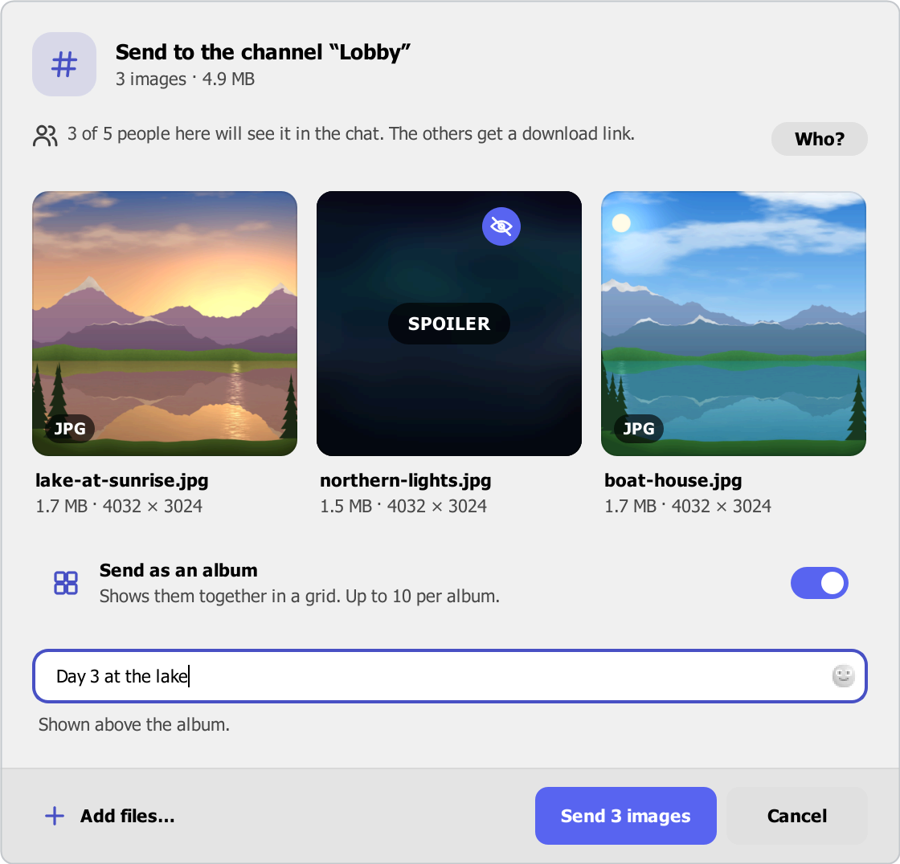
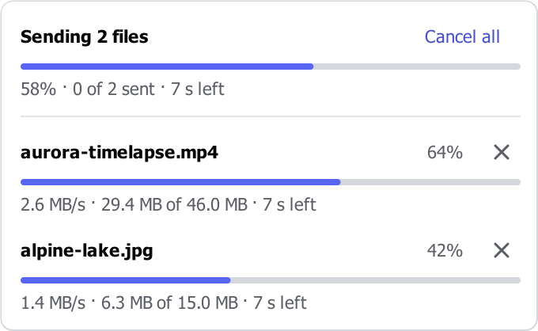
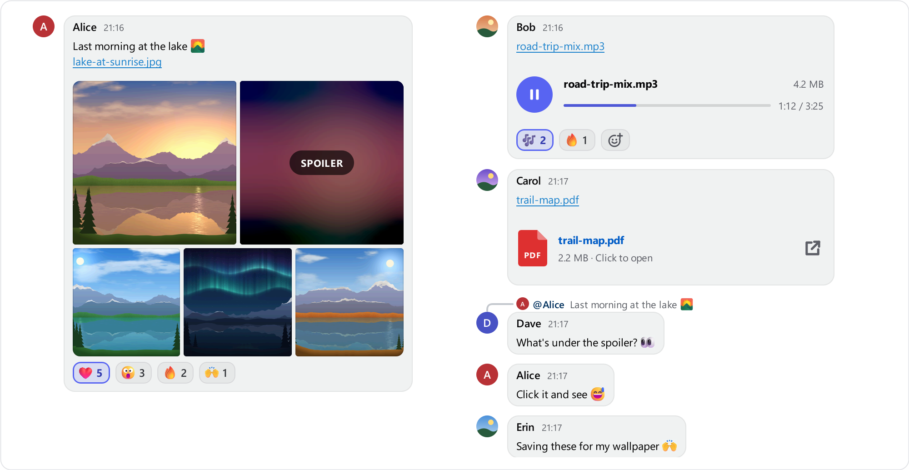
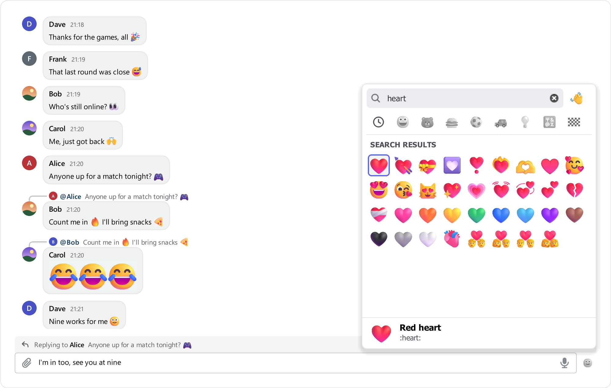
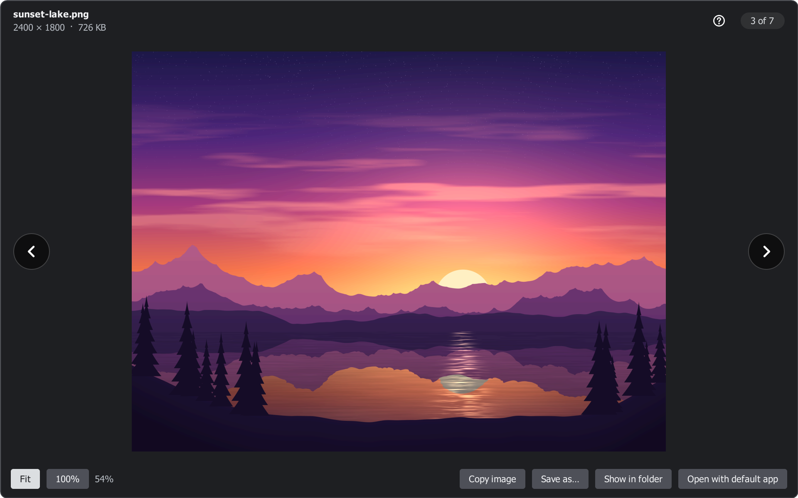

# Using TS Media chat

[← Back to README](../README.md)

How to send files, polls, voice messages and live music, reply to messages, use HD emoji, what you see in the chat (link previews too) and how it looks, how the gallery viewer works, and the chat commands.

- [Sending files](#sending-files): [the paperclip](#the-paperclip), [the send window](#the-send-window), [editing a picture](#editing-a-picture), [large videos](#large-videos), [upload progress](#upload-progress), [file names and folders](#file-names-and-folders)
- [Viewing media](#viewing-media): [albums](#albums), [spoilers](#spoilers), [audio](#audio-files), [reactions](#reactions), [link previews](#link-previews), [file checks](#file-checks), [data saver](#data-saver)
- [Chat proxy](#chat-proxy): link previews, the YouTube player and update checks through your VPN app's local port
- [Voice messages](#voice-messages), [live music](#live-music) and [polls](#polls)
- [Chat layout](#chat-layout)
- [Replies](#replies) and [emoji](#emoji)
- [Dragging files out of the chat](#dragging-files-out-of-the-chat)
- [Right-click menu](#right-click-menu), [gallery viewer](#gallery-viewer), [chat commands](#chat-commands) and [hotkeys](#hotkeys)

## Sending files

| Method | How |
| --- | --- |
| Drag & drop | Drop files on the chat messages or the chat input. The send window opens; hold <kbd>Ctrl</kbd> while dropping to send them right away. |
| Paste | Press <kbd>Ctrl</kbd>+<kbd>V</kbd> in the chat input. The send window opens. |
| Paperclip | Click the paperclip at the left end of the chat input → **Photo or video** or **Document**, then pick files. The send window opens. |
| Menu | **Plugins → TS Media chat → Send files to chat…** (greyed out while the current server tab is not connected) |
| Hotkey | *Send files to the current chat* (see [hotkeys](#hotkeys)) |
| Chat command | `/tsmedia send` |

- **Drag & drop:** you can drop one or more files at once. While you drag, the chat shows *Drop to send …*, where the files will go and what the drop does, or *Can't send files here* and the reason. A drop opens the send window; hold <kbd>Ctrl</kbd> while dropping to send right away instead (the setting *When you drop files on the chat* turns this round). Hold <kbd>Shift</kbd> while dropping to get TeamSpeak's normal behaviour. Drags from TeamSpeak's own file browser keep working as before, and files dragged out of the chat are never sent again.
- **Paste:** take a screenshot (for example with <kbd>Win</kbd>+<kbd>Shift</kbd>+<kbd>S</kbd>) or copy files in Explorer, click the chat input and press <kbd>Ctrl</kbd>+<kbd>V</kbd>. Plain text still pastes as usual. Text you already typed in the chat input becomes the caption; it is removed from the input once the caption is in the chat, and stays there if you cancel or the send fails.

Before the file picker opens, before the send window and when you drop files, the plugin checks that you are connected, that your channel has no password and that it knows who a private chat is with. If something is missing, it says why (next to where you are and in the chat), and nothing is sent.

Drag & drop and Ctrl+V sending can each be turned off in the [settings](SETTINGS.md#sending).

### The paperclip

The paperclip at the left end of the chat input opens a small menu (TeamSpeak's emoji button and the microphone stay at the right end):

| Entry | What it does |
| --- | --- |
| **Photo or video** | The file chooser, showing pictures and videos first; the files go into the [send window](#the-send-window). |
| **Document** | The file chooser for any file; the files go into the send window. |
| **Poll** | The *New poll* window ([polls](#polls)). Channel chats only. |
| **Live music** | Pick a music file to play to your channel ([live music](#live-music)). |

While the send window is open, **Photo or video** and **Document** add the chosen files to it. The menu works with the keyboard too: the arrow keys, <kbd>Home</kbd> / <kbd>End</kbd>, <kbd>Enter</kbd> and <kbd>Esc</kbd>. Entries that can't be used right now (not connected, not in a channel) are greyed out; pointing at one says why. Without a mouse, `/tsmedia send`, `/tsmedia poll` and `/tsmedia music` do the same as its entries.

### Where a message goes

- The message goes to the chat tab you are looking at: channel, server or a private chat. The file itself is always stored in the file browser of **the channel you are currently in**.
- If the partner of a private chat can't be identified (for example, they left the server), nothing is sent. Something meant for one person never ends up in the channel instead.
- When you send several files at once, albums come first, then the other files in the order you chose them. Up to two files upload at the same time; the others wait their turn.
- Messages go out one at a time and follow TeamSpeak's flood protection: when TeamSpeak asks the plugin to slow down, the upload panel says *TeamSpeak is limiting messages. Retrying…* and the message is sent again, instead of being lost.
- Messages from the plugin itself (an upload failed, a command's answer) appear in the chat tab you are looking at. If you have switched to another server's tab meanwhile, they go to the channel tab of the server they belong to.

### The send window

  

Pasting, dropping and the file picker all open the same window. It names where the files go (*Send to the channel “Lobby”*, the whole server or a private chat) and shows what will be sent: a large preview for one picture or video, or a list with a thumbnail, the name and the size of each file. Nothing is sent until you click **Send** (or press <kbd>Enter</kbd>); <kbd>Esc</kbd> closes it, and asks first if you changed something.

- **Caption:** one line of up to 300 characters, shown in the chat right above the file (above the first one, or above the album, when you send several). A counter appears from 250 characters. A caption that doesn't fit in the same chat message as the file is sent as its own message right above it; it is never shortened.
- **Mark as spoiler:** pictures, GIFs and videos can be marked one by one (the eye button in the list, <kbd>S</kbd> on a focused row). People with TS Media chat see them blurred until they click. People on TS Media 2.1 or older, and people without the plugin, see them unblurred.
- **Send as an album:** shown for two or more pictures and videos (on by default; the window remembers your choice). Up to 10 go into one album, so 12 pictures are sent as two albums (10 + 2). Other files are sent one by one.
- **Who will see it:** a line counts who in your channel has TS Media, for example *3 of 5 people here will see it in the chat. The others get a download link.* The **Who?** button lists the names. In a private chat it names your partner; alone in a channel it says *You're the only one in this channel. No one else will get this message.* People on TS Media 2.1 or older can't answer and count as getting a link. The line is hidden when you turned off *Tell people in your channel that you have TS Media*.
- **Edit…** (the pencil in the list, <kbd>E</kbd> on a focused row): crop and draw on a picture before you send it, see [editing a picture](#editing-a-picture). The item then says *Edited*; **Revert to original** (the arrow next to the pencil) brings the original back. Animated GIFs and pictures over 33 megapixels (16 in 32-bit TeamSpeak) can't be edited.
- **Quality** (videos): see [large videos](#large-videos).
- **Add files…** (<kbd>Ctrl</kbd>+<kbd>O</kbd>), dropping more files on the window, or <kbd>Ctrl</kbd>+<kbd>V</kbd> add files; the **×** button (or <kbd>Delete</kbd> on a focused row) removes one. Up to 100 files can be sent at once.
- Files that can't be sent (empty, larger than your upload limit, missing or open in another program) are marked with the reason before you click **Send**, and left out. The button says what will be sent (*Send 3 images*, *Send 5 files*). While you are not connected, or the person of a private chat has left, the window says so and **Send** stays off; what you entered is kept.

The clipboard may hold something old you forgot about, so a paste never sends anything without the window.

### Editing a picture

**Edit…** opens the picture in its own window. Nothing changes the original file: the edited picture is a new copy, and you can open the editor again to change or undo what you did.

| Tool | Key | What it does |
| --- | --- | --- |
| Crop | <kbd>C</kbd> | Drag the frame or its corners. *Free*, *Original*, *Square*, *4:3* and *16:9* set the shape, **Swap** (<kbd>X</kbd>) turns it between landscape and portrait, **Rotate** (<kbd>Ctrl</kbd>+<kbd>R</kbd>) turns the picture 90° clockwise, **Reset crop** shows the whole picture again. The arrow keys move the frame and <kbd>Shift</kbd>+arrows resize it. <kbd>Enter</kbd> applies the crop, <kbd>Esc</kbd> leaves it as it was. |
| Pen | <kbd>P</kbd> | Draw freehand. Hold <kbd>Shift</kbd> for a straight line. |
| Arrow | <kbd>A</kbd> | Drag from the tail to the tip. <kbd>Shift</kbd> keeps it at 45° steps. |
| Rectangle | <kbd>R</kbd> | Drag a frame. <kbd>Shift</kbd> makes a square. |
| Text | <kbd>T</kbd> | Click where the text should start, type, then <kbd>Enter</kbd>. Light colours get a dark outline and dark ones a light outline, so the text stays readable. |
| Hide details | <kbd>H</kbd> | Drag over something to hide it: *Pixelate* or *Black box*. Pixelate hides most details; for passwords, codes and addresses use *Black box*. |

- **Colours** (<kbd>1</kbd>–<kbd>6</kbd>): red, yellow, green, blue, white, black. **Sizes** (<kbd>[</kbd> and <kbd>]</kbd>): thin, medium and thick lines, or small, medium and large text. The editor remembers your last choice.
- <kbd>Ctrl</kbd>+<kbd>Z</kbd> undoes, <kbd>Ctrl</kbd>+<kbd>Y</kbd> (or <kbd>Ctrl</kbd>+<kbd>Shift</kbd>+<kbd>Z</kbd>) redoes. <kbd>Ctrl</kbd>+wheel zooms, <kbd>Ctrl</kbd>+<kbd>0</kbd> fits the window, <kbd>Ctrl</kbd>+<kbd>1</kbd> shows the picture at its actual size; hold <kbd>Space</kbd> and drag (or drag with the middle button) to move around.
- **Done** (<kbd>Enter</kbd>) keeps the edit, **Cancel** (<kbd>Esc</kbd>) asks first if you changed something.
- Lines and text keep the size you see on screen, at any zoom, and the edited picture is saved at the full resolution of what you kept (it is never enlarged).
- The edited picture keeps its name. JPEG and WebP photos are saved as JPEG (quality 92); screenshots (PNG, BMP), pasted pictures and anything with transparency as PNG, which becomes JPEG (quality 90) when it is over 2 MB without transparency and *Convert pasted images over 2 MB to JPEG* is on.
- The edited copy has no metadata: no EXIF, so no camera details and no location. Pictures you send without editing are sent exactly as they are, so a phone photo can still say where it was taken.

### Large videos

Videos larger than 25 MB, and iPhone (HEVC), AV1, VP9 or camcorder videos of any size, are converted on your computer to an MP4 (H.264 and AAC) that plays everywhere, before they are uploaded. Nothing is sent anywhere else, and a video is only compressed when that makes it at least 30% smaller.

- In the send window each video has a **Quality** list with the size each choice is expected to have: *Original*, *1080p*, *720p* and *480p* (in the large single view: *High (1080p)*, *Balanced (720p)*, *Smaller (480p)*). The default is what your [settings](SETTINGS.md#videos) say.
- A video over your upload limit gets a smaller quality that fits, picked for you; *Original* is then shown as *over the limit*. A video that can't be made small enough says why and what to do.
- While a video is compressed, the upload panel shows *Compressing · 240 MB → about 18 MB · 1 min left*, a **Send original** button (when the original fits your upload limit) and **×** to cancel. Other files of the same send keep going, and their messages still appear in the order you chose. When it is done, the panel shows *Sent · 240 MB → 18.0 MB*.
- If compressing fails, the original is sent when it fits (*Sent the original*; the panel's tooltip says why).
- The result keeps the random part of its name, with the extension `.mp4`. Extra sound tracks, subtitles and metadata (including the location some phones store in videos) are not kept.
- The graphics card does the work when it can, otherwise the processor; one video at a time, at a lower priority than TeamSpeak's own work. On Windows N editions without the Media Feature Pack, videos are sent as they are.

### Upload progress

  

A panel at the bottom of the chat shows each upload with its progress, in TeamSpeak's light or dark theme:

- An upload shows its percentage, the speed, the amount sent and the time left. Files waiting for their turn say *Waiting to upload…*; videos waiting for compression *Waiting to compress…*.
- With several files, a header shows the overall progress (*2 of 5 sent*), the time left and **Cancel all**. At most four files are listed, failed ones first; the rest are summed up as *+3 more*, which you can click to list as many as fit in the chat (*Show fewer · 2 not shown* counts the rest).
- The **×** button of a file cancels its upload, or dismisses it once it is finished. A file that is uploaded but still waits for earlier files (*Waiting for earlier files…*) or for the rest of its album (*Waiting for the rest of the album…*) can be canceled too: nothing is posted for it, it is removed from the channel's file browser again, and the album is sent without it.
- A failed upload says why and what to do next. It stays at least 10 seconds (15 with **Retry**), and never goes away while the pointer is on the panel. **Retry** sends the file again to the same chat when that is possible: not when the tab is now connected to another server or the private chat partner has left. When the file already reached the server but its message didn't (*TeamSpeak didn't confirm the chat message*), **Retry** posts the message again without uploading the file twice. Every failure is also written into the chat.
- `/tsmedia cancel` or the *Cancel all uploads* hotkey stop every running upload from the keyboard, files waiting for earlier ones included.

### File names and folders

- Files are uploaded as `/tsmedia/<name>_<8 random hex digits>.<ext>`, for example `/tsmedia/holiday_3f9a1c2e.jpg`. Spaces become `_`, unusual characters are replaced, the name (without the extension) is cut to 48 characters and 64 bytes (about 32 Persian or 21 Chinese characters), and the extension is lower-cased. The random part keeps names apart, and an existing file is never overwritten.
- Where the plugin shows a file name, it leaves the random part out (`holiday.jpg`). A pasted screenshot is called *Pasted image*. Spoilers are labelled *Spoiler (image)*, *Spoiler (GIF)* or *Spoiler (video)* in the chat link, and voice messages *Voice message (0:12)*.
- A pasted image is sent as `new_photo_<random>.png`, or converted to JPEG (quality 90) if it is larger than 2 MB and has no transparency. Voice messages are sent as `voice_message_<random>.m4a`, and compressed videos keep their name with `.mp4`.
- With *Upload a small preview* on (the default), a preview is stored as `/tsmedia/previews/<8 hex>.jpg`, with the same random part as the file. Previews are only made for photos larger than 1.5 MB or with a side longer than 2560 px (preview up to 1280 px), for animated GIFs and WebPs larger than 4 MB (first frame, up to 640 px), and for every video (poster up to 960 px).
- If the folder can't be created (no `i_ft_directory_create_power`), the file goes to the root of the channel's file browser; if only the previews folder fails, the preview goes next to the file as `<8 hex>.preview.jpg`.
- Every file you send carries its SHA-256 in the link, so receivers can check that they got the same file ([file checks](#file-checks)).
- The folder and the upload size limit (default 100 MB) can be changed in the [settings](SETTINGS.md#sending), also [per server](SETTINGS.md#servers).

## Viewing media

- **Images and GIFs** up to 15 MB load automatically. Larger ones show their preview (or a blurred placeholder) with the file size, and load when you click them. Clicking an image or GIF opens the gallery viewer.
- **Videos** show their poster, a play button and the duration. Clicking play downloads the video first (a progress ring shows the percentage) and then plays it right in the chat. Hover over a playing video to show its controls: play/pause, time, seek bar, mute and expand (opens the gallery viewer). Pointing at a control shows its name, and the seek bar shows the time under the pointer. The controls stay while the pointer rests on them and fade out 2.5 s after the mouse stops elsewhere.
- **Only one thing plays at a time:** starting a video, an audio file or a voice message pauses the others, in the chat and in the viewer.
- **Videos Windows can't play inside the chat** (a missing decoder, for example) show *Opens in default app*: clicking them opens your default video app.
- **Audio files** and **voice messages** play in the chat: see [audio files](#audio-files) and [voice messages](#voice-messages).
- **Other files** appear as cards. Click a card to download the file and open it with its default Windows app. Programs and scripts are never run: clicking the card downloads the file and shows it in Explorer, and once downloaded the card says *Show in folder*.
- **Ordinary TeamSpeak file links** (for example a file dragged from the file browser into the chat) get the same treatment, just without the dimensions, duration, blurred placeholder, preview and checksum that TS Media chat adds to its own links.
- Previews and cards light up when you point at them and when you press them. Point at a card or a failed preview to see the file's full name, size and status.
- You have to be connected to the server the file is on. Up to 3 downloads run at once, previews first. A file waiting for its turn says *Waiting to download…*.
- When something goes wrong, the reason is written on the preview or card. Failed cards have a **Retry** button, and clicking a failed picture tries again. Deleted files and files in password-protected channels can't be retried: their previews show the normal pointer and do nothing when clicked. The [FAQ](FAQ.md#what-do-the-messages-on-a-preview-mean) explains every message.
- With Windows animations turned off (**Settings → Accessibility → Visual effects → Animation effects**), GIFs play only while the pointer is over them, and loading indicators stand still.
- Previews follow the chat's text size: they grow with Windows display scaling and when you zoom the chat with Ctrl + mouse wheel (or change TeamSpeak's chat font), and the line you are reading stays where it is. **Settings → Receiving & playback → Preview size** makes them larger or smaller than the text.

### Albums

<picture>
  <source media="(prefers-color-scheme: dark)" srcset="images/album-dark.png">
  
</picture>

- Pictures, GIFs and videos sent as an album appear as one grid below the sender's line: 2 side by side, 3 as one large tile with two stacked, 4 as 2 × 2, 5 as 2 + 3, and 6 or more as 3 + 3 with *+N* on the sixth tile. In a narrow chat the grid has two columns and four tiles. It is as wide as your *Maximum preview size* and keeps its size while the pictures load.
- Only the album's first file link stays as a line in the chat (with the caption above it); the other links are folded away. People without the plugin see every link.
- Tiles show loading rings, a download button with the size, a *GIF* badge, and for videos a play button with the duration. Videos never play inside a tile.
- Clicking a tile (also *+N*) opens the viewer at that item, with the album's items in order. Right-click a tile for that file's menu. A downloaded tile can be dragged out like any picture.
- Turning *Show images, videos and file cards in the chat* off, or disabling the plugin, brings every folded line back.

### Spoilers

- A spoiler shows a blurred cover with a *SPOILER* pill. Click it to reveal it; right-click → **Hide spoiler** covers it again. A revealed spoiler stays revealed until TeamSpeak restarts.
- While covered, GIFs don't animate, videos don't play and nothing downloads automatically; it can't be copied or dragged out (*Reveal the spoiler first*). Reactions can be added without revealing it.
- In the viewer, a covered spoiler shows **Reveal spoiler**; click it or press <kbd>Space</kbd> or <kbd>Enter</kbd>.
- *Show spoilers without blurring* in the [settings](SETTINGS.md#spoilers) shows them right away.

### Audio files

- MP3, M4A, AAC, WAV, FLAC, OGG, Opus, WMA, MKA and WebA files show a player card with a play button, the name and size, a seek bar you can drag, and the time (*0:42 / 3:25*). It has the same size as a file card, so the chat never moves.
- An audio file downloads when you press play, unless *Download videos and audio automatically* covers its size. The card says *Downloading… 45% · 1.9 MB of 4.2 MB* meanwhile.
- Audio plays at the default volume, ignores the video mute button and *Start videos muted*, and never loops. It keeps playing while you look at pictures in the viewer.
- Right-click the card for **Play** / **Pause** / **Replay**. A file Windows can't play says *Can't play here · Click to open in your default app*; Ogg and Opus need *Web Media Extensions* from the Microsoft Store.

### Reactions

- Pictures, GIFs, videos, albums, audio files and voice messages (spoilers too, which stay covered) can get reactions with any emoji, drawn as HD pictures.
- 2.3: so can text messages, links, replies and polls in channel and private chats: point at the message and click **Add reaction** in its action bar, or right-click it → **Add reaction…**. The row of pills appears at the bottom of the message (inside its bubble when bubbles are on, like the row under media) and works like the one under media. People with TS Media 2.3 or later see these. Messages need TeamSpeak's timestamps (on by default).
- Point at a picture without reactions and click the round button at its top right, or the **+** pill at the end of an existing row, or right-click → **Add reaction**. The quick row offers eight: 👍 ❤️ 😂 😮 😢 🔥 and your two most recent other emoji. Its **+** opens the [emoji picker](#emoji) for any other one; there, a pick adds or removes that reaction, and your reactions are marked. The quick row works with the keyboard too: arrows, <kbd>Home</kbd> / <kbd>End</kbd>, <kbd>1</kbd>–<kbd>8</kbd>, <kbd>+</kbd> for the picker, <kbd>Enter</kbd> or <kbd>Space</kbd>, <kbd>Esc</kbd>. The right-click menu's **Add reaction** lists the quick ones, your others and **More reactions…**.
- The row under the media shows each reaction with its count, in the order they first appeared; yours are highlighted. Click a pill to add or remove yours, and point at it to see who reacted (*Thumbs up: you, Bob and Carol*). Everyone can add up to 10 reactions to one item, and an item shows up to 20 different ones.
- Reactions go through TeamSpeak, never to the server's files: people with TS Media 2.2 or later who are online in the same channel or private chat see them right away. Someone who comes in later sees the reactions of the people who are still there. They aren't available in the server chat.
- If a reaction can't be sent (not connected, TeamSpeak limiting messages, plugin commands blocked on the server), it is taken back and the tooltip says why.
- Your computer remembers reactions for 30 days. **Clear cache** in the settings removes them too. *Show reactions* (Privacy & updates) turns reactions off: none are shown or sent.

### Link previews

Since 2.4, web links in the chat get a preview under them (since 2.5 also pages, like Discord's embeds), in channel, private and server chats, in every chat layout:

- **YouTube videos** (`youtube.com/watch?v=…`, `youtu.be/…`, `youtube.com/shorts/…`) show a card with the channel, the title and the thumbnail. Since 2.5, a click on the thumbnail (**Play in a window**) plays the video with YouTube's own player, in a window of its own over TeamSpeak; the title and `youtube.com` open it in your browser.
  - The first time, the card asks *Play this video in a window?* (with links to YouTube's Terms of Service and Google's Privacy Policy): **Play** plays it and the question doesn't come again; **Open in browser** opens it in your browser and asks again next time.
  - The player is a window of its own over TeamSpeak (it can be moved, resized and maximized; its size is remembered). The card shows *Playing in a window*; a click on it brings the window to the front. Close it with its close box, **Esc**, or the (x) on the card (*Stop video*). Only one video plays at a time: another Play, a TS Media video or a voice message pauses or stops it, and minimizing TeamSpeak pauses it.
  - A stopped video shows where it stopped (`1:05` on the thumbnail) and plays on from there.
  - Videos whose owner doesn't allow playing them outside YouTube show *This video can only be watched on YouTube*, removed ones *Video unavailable*, other failures *Can't play this video here*; **Watch on YouTube** opens the video in your browser. Right-click such a card and choose **Try again** to try once more.
  - The card's menu: **Stop video** (while it plays), **YouTube Terms of Service**, and the usual items.
  - Turn it off with *Play YouTube videos in a TS Media window* (*Settings → Privacy & updates*): Play then opens the browser. Without the WebView2 Runtime and in 32-bit TeamSpeak videos always open in the browser. What your PC sends: [privacy](PRIVACY-SECURITY.md#playing-youtube-videos).
- **Links to pictures, GIFs and videos** (`.png`, `.jpg`, `.jpeg`, `.gif`, `.webp`, `.mp4`, `.webm`, `.mov`, `.m4v`) show the file itself, like a file sent in the chat: pictures open in the gallery viewer, GIFs animate, videos play inline with the usual controls. A video that is too large to play here shows its poster with **Open in browser**.
- **GIF and media sites** show the media itself, as if the file had been linked: Tenor, Giphy (also `gph.is`), Imgur (also `.gifv` and albums), Klipy (clips, stickers, memes, emoji, AI GIFs; its GIF pages are behind Klipy's own bot check today, so TS Media asks Klipy's public oEmbed for their GIF, whose answer doesn't name it yet: they get no preview until Klipy fixes that answer, and then work by themselves), Reddit videos (`v.redd.it`) and post links to pictures or videos, Streamable, Imgflip, Pinterest, 9GAG, Coub, Gyazo, Lightshot, ImgBB, Postimages, Gifer, Makeagif, Pixeldrain, Tumblr posts and Steam screenshots. GIF-like videos play silently in a loop like GIFs; videos with sound play with the usual controls.
- **Cards for well-known sites**: Vimeo, SoundCloud, Spotify, Apple Music, Dailymotion, Medal, X (and twitter.com), Bluesky, Twitch channels and clips, Kick, Steam, GitHub, Wikipedia (every language), Telegram channel posts, Discord invites and Reddit posts show the site's colour, the author, the title, a short text and a picture (a play symbol for videos, which open in your browser). Cards and media from pages that declare themselves for adults show their picture covered like a spoiler (click it to show it; **Show spoilers without blurring** shows it at once); a page without that flag may still be for adults.
- **Nextcloud and ownCloud shares** (`…/s/…` links to a public server) show the shared picture, GIF or video itself; other files and folders get a small card with the name, type and size (with **Show cards for other web pages** on). Password-protected and upload-only shares get nothing, and from a link to the share page, shares whose owner turned downloads off or set a download limit are never downloaded (a link straight to the file loads like any file link and counts as a download).
- **Other web pages** (**Show cards for other web pages**, on by default) get a card like Discord's: the page's colour, site name, title, a short text and its picture. The card appears when it is ready; a page with nothing usable gets none. A page that redirects to another website (a short link, for example) gets no card from the sender's plugin and isn't loaded by itself; **Load link previews** loads it, and its card then names the link's own site first and the website it went to after it.
- **Who loads it:** when the sender has TS Media 2.4 (2.5 for pages and sites) and sent the link in a channel or private chat, their plugin made the preview when they sent it and put it in the channel's files. You see it from your TeamSpeak server, like any other file, and never contact the website; until it arrives the card says *Waiting for the sender's preview…* (*Checking for the sender's preview…* while your PC asks whether they make one). Your own links show at once from your own download (*Making the preview…* first). Other links load from the website by themselves when they show on your screen (**Load link previews automatically**, on by default), which shows that website your IP address: cards always (also with data saver), pictures, GIFs and videos within your automatic download limit for images (15 MB by default; videos use your video limit if you set one), and with data saver only cards; 2 at a time, one per person, and a link waiting its turn shows **Load preview** until then. A larger file shows **Load preview** with its size (or that it is over your limit); a click loads pictures and GIFs up to 25 MB and videos up to 50 MB, larger ones say *Too large to preview here* with **Open in browser**. With the switch off, every such link waits for your click on **Load preview** (point at the card to read that this connects your PC to that website). When the sender's preview arrives before a link was loaded here, the card switches to it; when it is gone from the server (or isn't the file that was announced), the link is loaded like other links.
- **Which links:** YouTube videos, links to files (`.png`, `.jpg`, `.jpeg`, `.gif`, `.webp`, `.mp4`, `.webm`, `.mov`, `.m4v`; `http://` ones are loaded over https), the sites above and other web pages (also written without `https://`, which TeamSpeak links as `http://`; they are loaded over https), at most 3 per message (links to files and YouTube come first). Never: the plugin's own links, sign-in, confirmation or download links, documents and archives, TikTok, IMDb, Amazon, Google Maps and Deezer links. A preview that can't be loaded says *Couldn't load the preview* with **Retry** (through a proxy: *Couldn't load through the chat proxy* or *Couldn't load through your Windows proxy*; a site your network filters: *Your network blocks this site*; see [chat proxy](#when-something-goes-wrong)); a site that asks to wait shows *Site busy* and loads by itself later. Cards for other web pages show nothing while they load or when they fail: right-click the message and choose **Load link previews** to load (or retry) them by hand; with automatic loading off that is how they load. Previews go through your Windows proxy if you have one, or through the [chat proxy](#chat-proxy) when you turn it on ([details](PRIVACY-SECURITY.md#link-previews)).
- **Hide a preview:** point at the card and click **×**, or right-click it → **Hide preview**; the card becomes a small *Preview hidden · Show* pill until TeamSpeak restarts. Right-click also offers **Open in browser** and **Copy link** (the web address).
- **Your links:** when you send such a link, your plugin loads it once and shares the preview through the TeamSpeak server (you need upload permission in that channel). Turn that off with **Settings → Privacy & updates → Make previews for links I send**.
- **Turn previews off:** **Settings → Privacy & updates → Show previews for links to other websites**. Every card and preview goes, and nothing is loaded for them any more. To keep previews but load other people's links only on a click, turn off **Load link previews automatically**. To keep media and site cards but drop cards for other web pages, turn off **Show cards for other web pages**. Details: [privacy & security](PRIVACY-SECURITY.md#link-previews).
- Reactions and replies on a message with a link work as on any text message; the preview itself has no reactions of its own.

### File checks

- Every file sent with TS Media chat 2.2 carries its SHA-256 checksum in the link. After a download, the plugin checks that the file is the one that was sent; large files may show *Checking file…* for a moment.
- A file that doesn't match (for example, it was replaced on the server) is never shown or saved: the preview says *File doesn't match what was sent* and *Click to try again*. Right-click → **Copy details** copies both checksums and the file's path for a report.
- A file posted while its upload was still arriving at the server is downloaded again once the server has all of it; the preview says *Waiting for the sender's upload…* meanwhile. When you send, your message waits until the server has the whole file; if your connection drops meanwhile, the message fails, and **Retry** posts it once the server confirms the file (it isn't uploaded again).
- In the viewer, the name's tooltip of a checked file says *SHA-256 verified: this is the file that was sent.*
- Files from TS Media 2.1 or older and ordinary TeamSpeak links have no checksum; their size is still checked.

### Data saver

- *Data saver: pause automatic downloads* (**Settings → Receiving & playback**) stops automatic downloads of images, GIFs, videos, audio and voice messages; small previews still load. Your limits are kept for when you turn it off.
- Per server: **Plugins → TS Media chat → Pause automatic downloads on this server** (and **Resume…**), `/tsmedia datasaver on`, `off` or `default` (back to the setting for all servers), or **Settings → Servers**.
- Held items say *Data saver — click to load*. When you connect to a server with data saver on, the chat says so once per session.
- Data saver never holds back your uploads, reactions or the update check.

## Chat proxy

New in 2.6. Where YouTube, Klipy and other sites are filtered, the chat proxy sends TS Media's own web traffic (link previews, the YouTube player, update checks) through your VPN app's local proxy port, while TeamSpeak itself (the server connection, voice, chat and file transfers) stays direct. Keep your VPN app's TUN or VPN mode off: it would send TeamSpeak's voice abroad too, and TeamSpeak servers in your country often can't be reached that way.

### Setting it up

1. Start your VPN app and connect it to a server (TUN or VPN mode off; its "system proxy" option doesn't matter for TeamSpeak).
2. **Plugins → TS Media chat → Turn on chat proxy** (or **Settings → Privacy & updates → Chat proxy settings…**). The first time, the *Chat proxy* window opens with *Use a chat proxy…* ticked and the server `127.0.0.1` (once a proxy is saved, the menu item just turns it on).
3. Press **Find my VPN app**: it finds v2rayN (10808), Throne and Nekoray (2080), Clash Verge Rev (7897) and Hiddify (12334) at their usual ports on this PC and fills in the first that answers. Or choose **SOCKS5** (or **HTTP**), server `127.0.0.1` and your app's local port yourself, or copy a proxy link such as `socks5://127.0.0.1:10808` and press **Paste from clipboard**.
4. Press **Test**. *Works · 612 ms* means it works; anything else says what is wrong ([the texts](SETTINGS.md#chat-proxy)).
5. Press **OK**. The chat says *Chat proxy on: SOCKS5 proxy 127.0.0.1:2080. Link previews, the YouTube player and update checks use it; TeamSpeak itself doesn't.*

More VPN apps (Psiphon, Outline, Hiddify's service mode): [FAQ](FAQ.md#how-do-i-use-ts-media-with-my-vpn-app). Every field of the window: [settings](SETTINGS.md#chat-proxy).

### Turning it on and off

Turning it off keeps the proxy, so turning it on again needs no typing:

- **Plugins → TS Media chat → Turn on chat proxy** / **Turn off chat proxy** (only the one that applies is enabled);
- a TeamSpeak hotkey, *Turn the chat proxy on or off* ([hotkeys](#hotkeys)); with no proxy set up it only says so in the chat;
- `/tsmedia proxy on` and `/tsmedia proxy off`; `/tsmedia proxy` says what is in use and whether it works;
- **Settings → Privacy & updates → Chat proxy**: the **Turn on chat proxy** / **Turn off chat proxy** button acts at once.

Each prints one line in the chat (it names the proxy's address only when the proxy is on this PC). It applies at once, without restarting TeamSpeak: previews that are loading start again through the new route, and a YouTube video that is playing closes (*Closed: the chat proxy changed. Press Play again.*). While it is off, TS Media uses your Windows proxy settings (the default, as before 2.6) or no proxy, as chosen under *When the chat proxy is off* in its window.

### When something goes wrong

The chat proxy never falls back to a direct connection: when it doesn't work, nothing TS Media loads goes around it.

- *Paused · the proxy isn't working* with **Load preview**: the chat proxy doesn't work (for example, your VPN app was closed). Automatic previews wait instead of failing one by one, and one line in the chat says why, with a **Turn off chat proxy** link (once per failure, not for every link). **Load preview** tries one now. TS Media tries again by itself after 30 seconds (60 for a proxy on another computer), and paused previews load once it works; the chat says nothing more then.
- *Couldn't load through the chat proxy* with **Retry**: a preview you clicked, or one that failed in a way that may be the website's own (the proxy couldn't reach that site). Point at **Retry** to read why.
- *Couldn't load through your Windows proxy*: with *Use Windows proxy settings*, the proxy Windows names didn't work. Automatic previews then wait for a click (**Load preview**), clicked ones offer **Retry**. A Windows setting that names only a SOCKS proxy can't be used that way: the Chat proxy window offers **Use it as the chat proxy**.
- *Your network blocks this site*: your network's DNS gave the site a filtered address. **Use chat proxy** turns the chat proxy on and loads the card (when one is saved); **Set up proxy…** opens the Chat proxy window.
- Right-click such a card for **Turn off chat proxy** or **Turn on chat proxy**, and **Proxy settings…**.
- The YouTube player says *Can't play through the proxy* when the proxy can't be used for it (its card's menu has the same items).
- After you turn the chat proxy off (or switch between the Windows settings and no proxy), previews that waited for a proxy or failed through it and haven't loaded since load only when you click them (the line that turning the chat proxy off prints says so). Other previews follow the new route as usual: one that was loading starts again through it, and links that hadn't started loading yet (off screen, or waiting for their turn) load through it by themselves.
- The status line in **Settings → Privacy & updates → Chat proxy** and in the window says what is in use and what is wrong.

## Voice messages

<picture>
  <source media="(prefers-color-scheme: dark)" srcset="images/voice-dark.png">
  
</picture>

Record a short message and send it to the chat you are looking at, like in Discord or Telegram.

- **Hold to record:** press and hold the **microphone** at the right end of the chat input. Recording starts the moment you press it, so your first word isn't cut off. Where nothing can be sent (not connected, a password-protected channel, a private chat whose partner left), the microphone is greyed out and its tooltip says why.
- **While you hold it** a strip right above the chat input shows a pulsing red dot, the time out of 5:00, a live waveform and *Release to send · Move away to cancel*; the microphone turns red. A short sound plays when recording starts and stops (TeamSpeak plays it on your own speakers or headset; others don't hear it).
- **Send:** let go of the mouse button. Recording stops and the message is sent at once; there is no listening step.
- **Cancel:** move the pointer away from the microphone (about two centimetres, in any direction) before you let go: the strip turns red and says *Release to cancel*, and letting go there discards the recording. Move back to the microphone and it sends again. <kbd>Esc</kbd> while you hold also cancels.
- **A click isn't a recording:** let go within half a second and nothing is recorded or sent; the strip says *Hold to record, release to send* for a moment. A double click doesn't start anything either.
- **With the keyboard** (or if you'd rather not hold the button): **Plugins → TS Media chat → Record voice message…** or `/tsmedia voice` records in a small *Voice message* window instead, with a red dot and *Recording*, who the message goes to, the waveform and the time. The big **Send** (or <kbd>Enter</kbd>, or a click on the red microphone) sends it; **Cancel** (<kbd>Esc</kbd>) discards it, from 3 seconds on after asking (recording goes on while it asks). The window stays on screen for as long as the microphone is in use; closing it cancels the recording.
- **Your TeamSpeak microphone is muted** while you record, so people in your channel don't hear you live (others see you as muted until you finish). It is unmuted again as soon as recording stops, however it stops; if the connection dropped meanwhile, as soon as TeamSpeak is connected there again. If you unmute it yourself meanwhile, the plugin leaves it alone.
- **Limits:** at 4:30 the time turns red (the window says *30 seconds left*, the strip *Sent by itself at 5:00*); at 5:00 recording stops and the message is sent by itself, even while you still hold the button, and the strip or the window says so (held with the pointer away from the microphone, ready to cancel, it is kept in the window instead). Under half a second of sound, nothing is sent (*Too short to send*). Voice messages can't be sent from password-protected channels.
- **Kept for you:** if recording stops by itself (the microphone was unplugged, or the window was hidden), you aren't connected when it is sent, TeamSpeak never saw you let go of the microphone (you switched to another window with <kbd>Alt</kbd>+<kbd>Tab</kbd>, or a menu or another window took the mouse), or another chat came up while you held it, the *Voice message* window keeps the recording instead of sending it: press **Send** (once you are connected again), or close the window to discard it (from 3 seconds on it asks first). The microphone button in the chat input shows the window again.
- **The microphone** is the one TeamSpeak uses (**Tools → Options → Capture**) when the plugin can tell which one that is; otherwise Windows' default communications microphone, and the window says so. The recording is the raw microphone, without TeamSpeak's noise suppression.
- **Sent as** an `.m4a` file (AAC, about 0.73 MB a minute) through the normal upload, with the upload panel showing *Voice message*. People without the plugin get a *Voice message (0:12)* link that downloads a file any player can play.
- **Receiving:** a voice message is a compact card with a play button, its waveform and its length. It downloads by itself while *Download images, GIFs and voice messages automatically* is on (up to that limit, at most 16 MB), so it plays at once. Click the waveform to jump to a point. **Save as…** suggests *Voice message 2026-10-09 18-02.m4a*.
- The [FAQ](FAQ.md#voice-messages) lists the messages the window can show (*Microphone access is blocked*, *No microphone found*, *The microphone is busy*, …) with their fixes.

## Live music

Play a music file from your computer to everyone in your channel, through your own voice: everyone hears it, with or without the plugin, and you can keep talking over it.

- **Start:** click the paperclip in the chat input and choose **Live music** (or type `/tsmedia music`), then pick a file: MP3, M4A / AAC, FLAC, WAV or WMA; Ogg and Opus once Windows has the *Web Media Extensions* from the Microsoft Store. It plays to the channel you are in on the server tab you are looking at.
- **The music bar** sits right above the chat input while it plays, no extra window: a music note (grey while the channel doesn't hear it), the title and artist from the file's tags (else its name), play / pause, the elapsed time, a slider to drag forward or back (or click to jump), the length, the volume (click the speaker to mute, scroll on it to change) and **Stop**. Stop ends the music and the bar goes away; so does the end of the track. The reply bar and the hold-to-record strip stack with it, never over it.
- **On another server tab** (TeamSpeak shares one chat input between them) the bar stays, compact: the title, *on Weekend Squad › Lobby* (the server and channel it plays on), play / pause and **Stop**. TeamSpeak doesn't send from a server tab in the background, so the music pauses while you're on another server tab (the bar says so) and plays on when you go back to its tab, unless you paused it yourself; play in the compact bar takes you back there.
- **Keyboard:** <kbd>Tab</kbd> reaches the bar's buttons and sliders (clicking them leaves the cursor in the chat input). On the position slider the arrow keys move 5 seconds, <kbd>Page Up</kbd> / <kbd>Page Down</kbd> 30 seconds, <kbd>Home</kbd> / <kbd>End</kbd> to the start or the end. `/tsmedia music pause`, `/tsmedia music play` and `/tsmedia music stop` work too.
- **The volume** is the music's level for the channel and for you alike (50% by default, so your voice stays on top), and it is remembered.
- **Talking over it:** with voice activation, your voice goes out whenever TeamSpeak would send it anyway, mixed with the music; between words only the music goes. TeamSpeak doesn't start sending for the music alone while you are quiet, so when the music starts (or comes back after a pause) the plugin turns voice activation off for a moment, until TeamSpeak sends, with your microphone left out meanwhile; your own voice activation settings are not changed. With push-to-talk, TeamSpeak sends nothing while the key is up, so the plugin keeps your input open while the music plays on the tab you are looking at (and gives it back when you pause, stop, switch tabs or the track ends). The plugin can't see your push-to-talk key, so meanwhile your microphone is left out entirely: the channel hears only the music, and the bar says so.
- **When the channel can't hear it** the bar says why on a second line: your microphone or sound is muted in TeamSpeak, TeamSpeak has no microphone open on this server, or you have no talk power in the channel (without talk power you can't start music at all). While your microphone or sound is muted in TeamSpeak, the plugin sends nothing at all (with your sound muted you don't hear it either); the music goes on to the channel once you unmute. Muting the music itself (the speaker in the bar, or volume 0) stops sending it too.
- **It stops by itself** when you switch channels or get disconnected (the bar says so for a moment), and a file that can't be played shows why (*This file has no sound to play*, *Ogg and Opus audio need an extension…*).
- **Sound quality depends on the channel's codec:** TeamSpeak encodes the music like your voice. Channels set to **Opus Music** sound best; with a voice codec (*Opus Voice*, Speex, CELT) music sounds thin, and the bar mentions it when the music starts. Your channel admin sets the codec in the channel's settings.
- Nothing leaves your computer except your normal voice stream: the file itself is never uploaded.

## Polls

Ask your channel a question and let everyone with TS Media vote, like Telegram's anonymous polls.

<picture>
  <source media="(prefers-color-scheme: dark)" srcset="images/polls-music-dark.png">
  
</picture>

- **Make one:** click the paperclip in the chat input → **Poll** (or type `/tsmedia poll`). Type the question (up to 200 characters) and 2 to 10 answers (up to 100 characters each): <kbd>Enter</kbd> goes to the next answer or adds one, <kbd>Backspace</kbd> in an empty answer removes it, <kbd>Alt</kbd>+<kbd>↑</kbd> / <kbd>↓</kbd> or the grip moves one. Switch on *Allow multiple answers* to let people choose several. <kbd>Ctrl</kbd>+<kbd>Enter</kbd> posts, <kbd>Esc</kbd> cancels. Polls go to the channel chat.
- **Vote:** click an answer on the poll card (with multiple answers, tick them and click **Vote**). Then the card shows each answer's percentage, count and bar, a check on your choice and the total (*12 votes*). **Retract vote** takes it back, so you can vote again.
- **Anonymous:** nobody, not even the person who made the poll, can see who voted for what; the card shows only counts. Votes are taken in the channel the poll was posted in, from people with TS Media 2.3 who are there; someone who comes in later gets the counts from the others.
- **Without the plugin** people read the poll as text: the question, the numbered answers and a *Vote with TS Media chat* link to this project.
- Polls can get reactions, be replied to (the reply quotes *📊 Poll: …*) and copied like any message.
- How the anonymity works, and its limits: [polls](POLLS.md).

## Chat layout

<picture>
  <source media="(prefers-color-scheme: dark)" srcset="images/chat-layout-dark.png">
  
</picture>

TS Media chat gives TeamSpeak's chat a Discord-like look in your own view. Nothing is sent and nobody else sees a difference. Choose the look in **Settings → General → Chat layout**:

- **Cozy** (the default): names, avatars and times above the messages. Messages of one person within 7 minutes are grouped under one name; point at one to see its time. A reply always starts a new group and shows its reply row above the name. Every message sits in its own bubble, like in Telegram, yours tinted with the accent colour, with its pictures, file, audio and voice cards, polls and reactions inside (cards then have no box of their own). The bubbles can be turned off.
- **Your messages on the right** (Cozy with bubbles, 2.3.1): like in Telegram, your own messages sit on the right and everyone else's on the left. Yours show no name or avatar; each bubble is as wide as what it holds and shows its time, after the last line or under a picture or card. Right-to-left text such as Persian is right-aligned in its bubble, and so are its reactions. A reply's row sits above your bubble, flush right. Turn it off with **Show my messages on the right**.
- **Compact:** one line per message, with the time in front.
- **TeamSpeak classic:** TeamSpeak's own look. Switching applies at once, and TeamSpeak's own chat comes back exactly as it was.

In Cozy and Compact:

- **Day dividers** read *Today, October 10, 2026*. Joins, leaves, TS Media's own notes and other system lines become small centred rows with an icon and their time (on small pills with bubbles), and so do TeamSpeak's status lines in the server tab and in private chats (*You switched from channel …*, *Chat partner disconnected …*); where TeamSpeak's saved chat history begins, a *History* divider shows its day. Four or more in a row show their first with *+N more events*: click it to see them all, *Show fewer* folds them again. Pokes, kicks, bans, errors, welcome and host messages always show.
- **Message actions:** point at a message for **Add reaction**, **Reply**, **Copy text** and **More**. With bubbles they sit at the bubble's top right (top left for your messages on the right) and keep off the message's text, also near the bottom of the chat. They are in the right-click menu too, and hidden when the chat is narrower than 240 px.
- **Mentions:** a message from someone else with your nickname or *@nickname* in it gets a tint and a bar.
- **Avatars** are TeamSpeak's own pictures of people, yours included, also for people who have left; TS Media downloads nothing (TeamSpeak may fetch a missing picture from the server, as when you click someone), and people without one get their initials on a coloured disc.
- Links keep their colour and underline. Copying gives TeamSpeak's own text.
- The chat keeps a little room under its newest message, so it never touches the chat tabs below, and stays at its end when new messages come in.

Grouping, message actions, bubbles, your messages on the right, avatars, mentions and folding can each be turned off in the [settings](SETTINGS.md#chat-layout).

## Dragging files out of the chat

- Drag a downloaded picture, GIF, video, album tile or file card from the chat to the Desktop, an Explorer folder or another app (Discord, a browser, Word, …). From the viewer, drag the picture, the video or the name in the title. The file arrives with its clean name (`holiday.jpg`, `Pasted image.png`).
- Not downloaded yet? Dragging starts the download: *Downloading… Drag it again when it's ready.*
- Without a mouse: right-click → **Copy file**, or <kbd>Ctrl</kbd>+<kbd>Shift</kbd>+<kbd>C</kbd> in the viewer (*File copied. Paste it into a folder with Ctrl+V.*).
- Dragged and copied files carry Windows' "downloaded from the internet" mark, like a browser download: Windows asks before running a program, and Office opens documents in Protected View.
- Dropping a file dragged from TS Media chat back on a chat does nothing, so nothing is uploaded again by accident. Covered spoilers can't be dragged.

## Right-click menu

Right-click any preview or card. The item in bold is what a click on the preview does.

| Item | Shown for |
| --- | --- |
| Play / Pause / Replay | videos, audio files and voice messages (*Open in default app* for ones Windows can't play inside the chat) |
| Mute / Unmute | videos that have been started |
| Reveal spoiler / Hide spoiler | spoilers |
| Download | files that are not downloaded yet |
| Retry download | files whose download failed (not for deleted files or password-protected channels) |
| Open | everything except deleted files, files in password-protected channels, and programs and scripts (media opens in the viewer, other files in their default app) |
| Open with default app | downloaded images and videos |
| Show in folder | downloaded files |
| Save as… | downloaded files (confirms *Saved to …* with the folder's name) |
| Copy file | downloaded files (paste it into a folder with <kbd>Ctrl</kbd>+<kbd>V</kbd>) |
| Save to GIFs / Remove from GIFs | GIFs: web GIFs and GIF-like loops, and downloaded GIF files (*Save to GIFs (download it first)* before that); see [GIFs](#gifs) |
| Copy image | downloaded images and GIFs (confirms *Image copied*) |
| Copy link | always (copies the `ts3file://` link and confirms *Link copied*; for a [link preview](#link-previews), the web address) |
| Load preview / Retry / Open in browser / Show preview | [link previews](#link-previews): what a click on the card does |
| Open in browser, Hide preview | [link previews](#link-previews), also site and page cards |
| Load link previews | 2.5: a link preview whose message has a link that shows no card, an error or **Load preview** (loads or retries that message's links) |
| Copy details | files that don't match what was sent (both checksums and the path) |
| Add reaction | pictures, GIFs, videos, albums, audio and voice messages, and (2.3) text messages, outside the server chat (with counts and who reacted, and *More reactions…* for any emoji) |
| Reply / View N replies | at the top, for the message the preview is in ([replies](#replies)) |

Right-click a message itself (not a preview) and TeamSpeak's own chat menu opens, with these at its top:

| Item | Shown for |
| --- | --- |
| Reply | any message ([replies](#replies)) |
| View 3 replies / View 1 reply | a message that has replies |
| Add reaction… | 2.3: a text message, link or reply in a channel or private chat (the quick reactions at the pointer; disabled with the reason when reactions can't be sent) |
| Load link previews | 2.5: a message with a link that shows no card, an error or **Load preview** (loads or retries its links by hand; this connects your PC to their websites) |
| Copy text | any message: what was written, without the time and name (and without a reply's quote line), with emoji and smileys as text; the selection instead when you right-clicked inside it |
| The emoji's name, Copy emoji, Use in the chat input | an HD emoji under the pointer ([emoji](#emoji)) |

When TeamSpeak shows no menu of its own there, a small menu with the same items opens.

## Replies

<picture>
  <source media="(prefers-color-scheme: dark)" srcset="images/replies-emoji-dark.png">
  
</picture>

Reply to any message in a channel, server or private chat, yours or someone else's, with or without the plugin on their side.

- **Start a reply:** right-click the message and choose **Reply** (it's at the top of TeamSpeak's own chat menu, and of the menu of a picture or file). Or press <kbd>Alt</kbd>+<kbd>↑</kbd> in the chat input: that picks the newest message, and pressing it again goes further back (<kbd>Alt</kbd>+<kbd>↓</kbd> goes forward again). TeamSpeak's hotkey settings also offer *Reply to the last message in the current chat*.
- A bar above the chat input says *Replying to Alice* with the start of her message. Click it to see that message again. Type your reply and press <kbd>Enter</kbd>. <kbd>Esc</kbd> or the **×** cancels it. TeamSpeak commands (`/…`) are sent as usual and don't end the reply. Switching to another chat tab hides the bar; it's back when you return.
- **Files as a reply:** while the bar is shown, files you paste, drop or pick go out as the reply. The send window says *Replying to …*; its **×** sends them without the reply.
- **What others see:** the reply starts with a quote line, *↪ Alice · 21∶14: “the start of her message…”*, followed by your text, so people without the plugin (and people on 2.1) can follow too: they see that italic line as text. With the plugin, the quote line becomes a small reply line above the message, with the author in their chat colour. Click it to scroll to the original message, which lights up for a moment. If the original isn't in the chat any more (an old message, another session), the line stays grey and its tooltip says so.
- Emoji in the quoted text keep their place: the reply line, the bar and *View replies* show them as HD emoji, and people without the plugin see them in TeamSpeak's own way. TeamSpeak's smileys (`:)`, `;)` …) stay text there for now. A reply of nothing but emoji shows them large, like any message of only emoji.
- **View replies:** right-click a message that has replies and choose **View 3 replies** to see who answered and what; click a reply (or use the arrow keys and <kbd>Enter</kbd>) to go to it.
- The time in a quote line uses the ratio sign (∶) instead of a colon, because TeamSpeak turns `:0` and `8)` into emoticons. A reply that would be longer than TeamSpeak's message limit quotes less of the original first; if your text alone is too long, it isn't sent and the input keeps it.

## Gallery viewer

  

The viewer shows every picture, GIF and video of the chat, so you can step through them without closing it. The counter shows which item you are looking at.

- The mouse wheel zooms around the pointer, and dragging pans the image.
- Double-clicking an image switches between *fit to window* and 100%, zooming into the point you clicked (200% when the picture already fits at 100%). 100% shows one image pixel per screen pixel, so on a scaled display (125%, 150%, …) pictures look smaller at 100% than in other apps that scale them up.
- Clicking a GIF pauses or resumes it. Clicking a video plays or pauses it, and double-clicking a video toggles full screen.
- The bottom bar has **Fit**, **100%**, **Copy image** (**Copy frame** for videos and GIFs), **Save as…**, **Show in folder** and **Open with default app** (not offered for programs and scripts, which are only shown in their folder). Fit and 100% show which view is active.
- Drag the picture, the video or the name in the title to a folder or another app to copy the file there.
- A spoiler stays covered until you click **Reveal spoiler** or press <kbd>Space</kbd>; nothing loads or plays before that.
- Full screen keeps a header with the name, the position in the gallery, Copy, Save, Open and Exit. The controls and the pointer hide while you don't move the mouse.
- Messages say what went wrong first and offer the way out right below: **Retry**, **Open with default app**, or **Get it from Microsoft Store** when a video needs a decoder from the Store.
- Volume changes made in the viewer are remembered.
- Images that are not downloaded yet load when you step to them. Videos wait until you press play, unless they are small enough to download automatically.
- The **?** button in the top bar (or <kbd>?</kbd> / <kbd>F1</kbd>) shows the keyboard shortcuts.

### Viewer keyboard shortcuts

| Key | Action |
| --- | --- |
| <kbd>←</kbd> / <kbd>→</kbd> | previous / next item of the gallery (seek 5 s when the video is the chat's only item) |
| <kbd>Shift</kbd>+<kbd>←</kbd> / <kbd>Shift</kbd>+<kbd>→</kbd> | seek 5 s back / forward (video); move a zoomed picture |
| <kbd>Space</kbd> or <kbd>K</kbd> | play / pause a video; pause / resume a GIF; reveal a spoiler |
| <kbd>Home</kbd> | back to the start of the video |
| <kbd>M</kbd> | mute / unmute |
| <kbd>L</kbd> | loop on / off |
| <kbd>↑</kbd> / <kbd>↓</kbd> | volume up / down by 5% (video); move a zoomed picture |
| <kbd>F</kbd> | full screen |
| <kbd>Esc</kbd> | leave full screen, otherwise close the viewer |
| <kbd>0</kbd> | fit the image to the window |
| <kbd>1</kbd> | 100% (one image pixel per screen pixel) |
| <kbd>+</kbd> / <kbd>−</kbd> | zoom in / out |
| <kbd>Ctrl</kbd>+<kbd>C</kbd> | copy the image, or the current video frame |
| <kbd>Ctrl</kbd>+<kbd>Shift</kbd>+<kbd>C</kbd> | copy the file, to paste it into a folder |
| <kbd>Ctrl</kbd>+<kbd>S</kbd> | save as… |
| <kbd>Ctrl</kbd>+<kbd>O</kbd> | open with default app |
| <kbd>Tab</kbd> / <kbd>Shift</kbd>+<kbd>Tab</kbd> | move between the buttons of the bottom bar and of a message (the player controls use the keys above) |
| <kbd>Enter</kbd> | press the highlighted or focused button; reveal a spoiler |
| <kbd>?</kbd> or <kbd>F1</kbd> | show the shortcut list |

Letter and number keys also work with non-Latin keyboard layouts. After a mouse click in the viewer, the keys act on the media again.

## Emoji

- **HD emoji in the chat.** Emoji in messages (yours and everyone's, in channel, server and private chats and in the chat history) show as sharp, colorful pictures, about the size of the text and never making a line taller (also after zooming the chat with <kbd>Ctrl</kbd> and the mouse wheel). TeamSpeak's own smileys (`:)`, `;)`, `:D`, `8)`, `:(`, `:P` …) become the matching emoji too. A message of nothing but emoji (up to 27) shows them large, like in Discord. Point at an emoji to see its name.
- Everyone with TS Media sees them like this; people without it see TeamSpeak's own rendering. Nothing about the message changes: it is plain text with Unicode emoji.
- Left as they are: links (also nicknames and file names), the TS Media link with its *plugin required* note, and characters that are text unless marked as emoji (©, ™, arrows, digits). Windows draws no country flags, so those stay letters.
- **Copying** (<kbd>Ctrl</kbd>+<kbd>C</kbd> or TeamSpeak's own *Copy*) gives the text with the emoji and smiley codes in place. Right-clicking an emoji opens TeamSpeak's chat menu with the emoji's name, *Copy emoji* and *Use in the chat input* at the top, followed by *Reply* and *Copy text* (the message, or the selection when you right-clicked inside it); see the [right-click menu](#right-click-menu).
- **The emoji picker.** Click TeamSpeak's emoticon button next to the chat input (it shows an HD face), or press <kbd>Ctrl</kbd>+<kbd>E</kbd> there (Windows' own panel, <kbd>Win</kbd>+<kbd>.</kbd>, works too). If TeamSpeak hides its button, a smiley inside the chat input, left of the microphone, takes its place. About 1,600 emoji in eight groups, with *Recently used* first, a search by name or word (`joy`, `+1`, `:fire:` …), a skin-tone choice and a preview with the name. Typing searches right away; <kbd>↓</kbd> or <kbd>Tab</kbd> moves into the grid, the arrows move there, <kbd>Page Up</kbd> / <kbd>Page Down</kbd> jump a group, <kbd>Enter</kbd> inserts and closes, <kbd>Shift</kbd>+<kbd>Enter</kbd> or <kbd>Shift</kbd>+click inserts and keeps it open, <kbd>Esc</kbd> clears the search or closes; <kbd>Ctrl</kbd>+<kbd>E</kbd> or the button again closes it too. The send window's caption field has the same button.
- **Reactions** use the same HD emoji, and any emoji can be one ([reactions](#reactions)).
- Reply lines, the reply bar and *View replies* show emoji in HD too ([replies](#replies)).
- The options are under [Settings → General → Emoji](SETTINGS.md#emoji).

### GIFs

The emoji picker of the chat input has two pages on top, **Emoji** and **GIFs**, like Telegram. The GIFs page keeps the GIFs you send, newest first, so one click sends one again.

- **What goes in by itself** (while *Remember GIFs I send* is on, the default): links you send to a GIF on Giphy (also `gph.is`), Tenor, Klipy (GIFs, stickers, emoji, AI GIFs), Imgur `.gifv`, Imgflip, Gifer and Makeagif; `https` links to a `.gif` (or an animated `.webp`) file without a `?` part; and GIF files you upload with TS Media (not spoilers), once their message is in the chat. A link that turns out to be a still picture, a video, a page marked for adults or a dead link leaves the list again. Links that can carry a private share token or that expire (Dropbox, Discord, Nextcloud and ownCloud shares, links with a `?` part, `http` links) and video links are never kept by themselves.
- **Save to GIFs**: right-click any GIF in the chat (a web GIF, a GIF file someone sent, a GIF-like looping video) → *Save to GIFs*. A GIF file must be downloaded first (the item says so). When it is in the list already, the item reads *Remove from GIFs*. A revealed spoiler is kept covered and sent as a spoiler again.
- **Sending**: a click sends the GIF at once to the chat the picker was opened from and closes the picker; <kbd>Shift</kbd>+click keeps it open. A link GIF goes out as its link (people with TS Media see it as usual; your own chat shows it from the cache). A GIF file is **uploaded again** to your channel's file browser through the normal upload, with its progress and limits, so every resend is a new file on the server. While a reply is being written, the GIF goes out as that reply. In the server chat, links go to everyone; files go into your channel's files and their link into the server chat (people outside your channel may not be able to download them). At most one send every 0.8 seconds per server, and none while two link GIFs still wait to go; a click right after the picker opened on the GIFs page (or after a page switch) sends nothing, so a habitual click never posts a GIF; a chat or server tab that changed since the picker opened closes the picker, and nothing is sent.
- **Unavailable tiles** are greyed with the reason in the footer: not connected, a private partner who left, a password-protected channel or a server that refused your upload (files only), a file over your upload limit, or a saved copy that is gone.
- **Keys**: a mouse opening shows the page you used last; <kbd>Ctrl</kbd>+<kbd>E</kbd> always opens on the emoji. <kbd>Ctrl</kbd>+<kbd>Tab</kbd> switches the page. On the GIFs page the arrows, <kbd>Home</kbd> / <kbd>End</kbd> and <kbd>Page Up</kbd> / <kbd>Page Down</kbd> move; <kbd>Enter</kbd> sends only after you moved with them (<kbd>Shift</kbd>+<kbd>Enter</kbd> keeps it open); <kbd>Space</kbd> and <kbd>Delete</kbd> do nothing there; typing a letter goes back to the emoji search; <kbd>Shift</kbd>+<kbd>F10</kbd> opens the menu.
- **Right-click a tile** (or the ⋯ button): *Send*, *Copy link*, *Reveal* (spoilers), *Remove*, *Remove all GIFs…* (asks first, inside the picker) and *Remember GIFs I send*. Remove has no undo: sending or saving the GIF again brings it back.
- Only the GIF under the pointer (or the keyboard) moves, after a short rest. Opening the page never contacts a website: everything comes from this PC. Only sending a link GIF can lead to a preview fetch, exactly as typing the link would. With *Show previews for links* off, sent GIF links are still kept, with a plain "GIF" tile.
- The list lives in `plugins\tsmedia\gifs` (at most 100 GIFs, copies up to 25 MB each and 256 MB in all; the least recently used go first). *Clear cache* doesn't touch it. See [privacy](PRIVACY-SECURITY.md#your-gifs).

## Chat commands

| Command | What it does |
| --- | --- |
| `/tsmedia send` | pick files and send them to the current chat (opens the send window) |
| `/tsmedia voice` | record a voice message for the current chat |
| `/tsmedia poll` | open the *New poll* window for your channel ([polls](#polls)) |
| `/tsmedia music` | pick a music file and play it to your channel ([live music](#live-music)); `pause` pauses it, `play` plays it on (from another server tab it takes you back to the music's tab), `stop` stops it |
| `/tsmedia cancel` | cancel all running uploads |
| `/tsmedia settings` | open the settings |
| `/tsmedia cache` | open the media cache folder |
| `/tsmedia datasaver` | show whether data saver is on for this server; `on`, `off` or `default` change it |
| `/tsmedia proxy` | say whether the [chat proxy](#chat-proxy) is on, what it uses and whether it works; `on` or `off` turns it on or off (2.6) |
| `/tsmedia update` | check for a new version now (official builds; see [updates](UPDATES.md)) |
| `/tsmedia diag` | open *Diagnostic info* (also **Settings → General → Diagnostic info…**): versions, settings, session counts and recent plugin messages to copy into a bug report. File names are hidden unless you tick *Include file names*; server addresses, server and channel names and nicknames are never included. *Copy and open bug report* also opens the GitHub form in your browser with the version fields filled in. |
| `/tsmedia help` or `/tsmedia` | print the version and the list of commands |
| `/tsmedia debug` | write a list of TeamSpeak's chat widgets to `widget_dump.txt` in the plugin's data folder (`%APPDATA%\TS3Client\plugins\tsmedia`) for bug reports; the chat says *Diagnostics saved to …* |

An unknown command is named in a warning, followed by the list of commands.

## Hotkeys

In **Tools → Options → Hotkeys**, click **Add**, then **Show Advanced Actions**, and pick one under **Plugins → Plugin Hotkey → TS Media chat**:

| Hotkey | What it does |
| --- | --- |
| Send files to the current chat | opens the file picker for the chat you are looking at |
| Cancel all uploads | stops every running upload |
| Reply to the last message in the current chat | starts a reply to the newest message of the chat you are looking at ([replies](#replies)) |
| Turn the chat proxy on or off | turns the [chat proxy](#chat-proxy) on or off (2.6); with none set up it only says so in the chat and opens no window |

2.2.0's *Record a voice message* hotkey is gone since 2.2.1 (use the microphone in the chat input). If you had bound it, it no longer does anything; you can remove it from TeamSpeak's hotkey list.

The **Plugins → TS Media chat** menu also has **Pause automatic downloads on this server** / **Resume automatic downloads on this server**, **Turn on chat proxy** / **Turn off chat proxy** ([chat proxy](#chat-proxy)), **Check for updates…** (official builds), **Settings…** and **Open media cache folder**. Server admins find **Give TS Media chat access** and **Remove TS Media chat access** in a client's right-click menu ([server admin guide](SERVER-ADMIN.md#one-click-ts-media-chat-group)).
