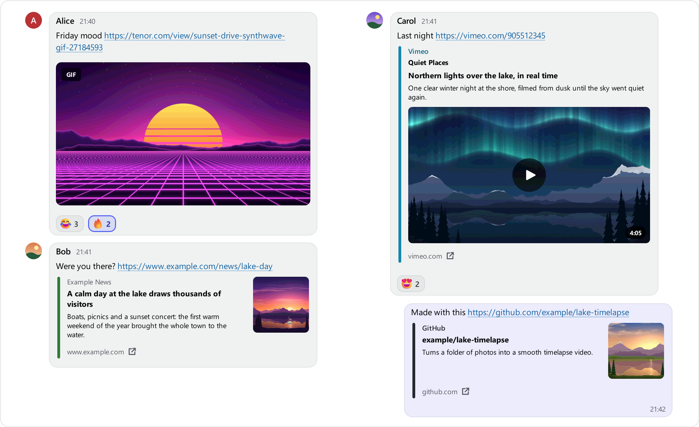

## ⬇️ [Download TSMedia-2.5.0.ts3_plugin](https://github.com/Metihttp/Teamspeak_Media_chat/releases/download/v2.5.0/TSMedia-2.5.0.ts3_plugin)

**For TeamSpeak 3, this is the only file you need.** Double-click it to install. The other files further down are used by automatic updates; ignore them.

---

**TS Media chat 2.5.0** makes links in your TeamSpeak chat look like Discord's: GIFs and videos from page links play right in the chat, YouTube plays in a small player window, and previews stay sharp on 4K screens.

### Highlights

- **Page links like Discord.** Links to Tenor, Giphy, Imgur, Klipy and other GIF and video sites show the GIF or video itself, playing in the chat.
- **YouTube in a player window.** Play on a YouTube card plays the video with YouTube's own player in a small window over TeamSpeak.
- **Sharp on 4K screens.** Previews grow with Windows scaling, chat zoom and TeamSpeak's chat font; Preview size makes them larger or smaller.
- **Nextcloud and ownCloud shares.** Share links show the picture, GIF or video itself; other files and folders get a small card.
- **A GIFs tab in the emoji picker.** The GIFs you send are kept on your PC, and one click sends one again, like Telegram.
- **Cards for sites and web pages.** Vimeo, Spotify, GitHub, Wikipedia, X and other pages get a card with a title, a short text and a picture.
- **Made by the sender, as before.** The sender's plugin makes the preview once and shares it through your TeamSpeak server, so your PC doesn't contact the website.

### What's new

- **Page links of GIF and video sites**, as asked for in [issue #1](https://github.com/Metihttp/Teamspeak_Media_chat/issues/1): Tenor, Giphy (also `gph.is`), Imgur (also `.gifv` and albums), Klipy (clips, stickers, memes), Reddit, Streamable, Imgflip, Pinterest, 9GAG and more show the GIF or video itself. GIF-like videos play silently in a loop, like GIFs.
- **YouTube player window.** Play on a YouTube card opens YouTube's own player in its privacy-enhanced mode (`youtube-nocookie.com`, in Microsoft Edge WebView2) in a small window over TeamSpeak. Nothing of the player loads before you press Play, and the card asks once the first time. The window can be moved, resized and maximized; Esc closes it, minimizing TeamSpeak pauses it, and only one video plays at a time. 64-bit TeamSpeak only: in 32-bit TeamSpeak, Play opens your browser.
- **Previews follow zoom and high-DPI screens.** Pictures, GIFs, videos, albums, cards, polls and reactions are drawn in proportion to the chat's text and stay sharp at 150% or 200% Windows scaling, with Ctrl + mouse wheel over the chat and with TeamSpeak's chat font. The line you are reading stays in place. **Preview size** (*Settings → Receiving & playback*): Small, Normal, Large or Larger.
- **Nextcloud and ownCloud share links** (`…/s/…`) show the shared picture, GIF or video inline, and a card for other files and folders. Password-protected shares get no preview, and servers on a LAN, a VPN or a private address are never contacted.
- **GIFs tab** in the emoji picker: the GIFs you send (GIF site links, GIF links and GIF files you upload) are kept, newest first; one click sends one again, and right-click → **Save to GIFs** keeps someone else's. Stored only on your PC: no search, and opening the tab contacts no website. *Remember GIFs I send* and *Remove all GIFs…* are in *Settings → General → Emoji*; *Clear cache* keeps your GIFs.
- **Cards** for well-known sites (Vimeo, SoundCloud, Spotify, Dailymotion, X, Bluesky, Twitch, Kick, Steam, GitHub, Wikipedia, Telegram, Discord invites, Reddit and more) and for other web pages: the site's colour, title, a short text and a picture; a click opens the link in your browser. Web pages are read only up to the end of their head, never shown or run.
- **The same privacy model as 2.4.** When someone with TS Media 2.5 sends such a link in a channel or private chat, their plugin makes the preview once and shares it through the TeamSpeak server; you see it from there without contacting the website. Links from people without the plugin load by themselves when they show on your screen, within your automatic download limits.
- **Switches** in *Settings → Privacy & updates*: *Show cards for other web pages* drops the text cards of other web pages and keeps media and site cards; *Play YouTube videos in the chat* off opens YouTube videos in your browser; right-click a message → **Load link previews** loads or retries its previews by hand.

### Fixed

- A site that answers "too many requests" no longer turns previews into error cards: requests to one site are spaced out, and its cards load by themselves once the site allows it.
- Links a sender's plugin skipped because of its per-minute limit no longer keep everyone waiting for minutes.
- Cards above the automatic download limit load by themselves once the limit is raised.

### Good to know

- Klipy's GIF pages (`klipy.com/gifs/...`) are behind Klipy's own bot check for apps that don't run a browser, so they get no preview yet. TS Media asks Klipy's public oEmbed instead, and picks up the GIF by itself once Klipy fixes that answer. Klipy's clips, stickers and memes work.
- Where YouTube is blocked, YouTube previews and the player need a VPN. Previews made by the sender come from your TeamSpeak server and need no VPN.
- Who contacts which website, and when, and what the YouTube player sends: [privacy & security](https://github.com/Metihttp/Teamspeak_Media_chat/blob/v2.5.0/docs/PRIVACY-SECURITY.md#link-previews).

### Install or update

**On 2.2.x, 2.3.x or 2.4.0:** it updates itself. Wait for the update offer, or use **Check for updates…** in the plugin menu. Your settings, cache and GIFs are kept.

**On 2.1 or older, or new here?** Close TeamSpeak, double-click the file above, then type `/tsmedia` in the chat.

### Known issues

- The 32-bit DLL is untested on a real 32-bit client, and it has no YouTube player (Play opens your browser).
- After **Options → Addons → Reload**, the chat may no longer be scrolled to its end.
- TeamSpeak may crash or hang when it quits, with or without the plugin: [workaround](https://github.com/Metihttp/Teamspeak_Media_chat/blob/main/docs/FAQ.md#teamspeak-crashes-or-hangs-when-i-quit).

[All known issues and answers](https://github.com/Metihttp/Teamspeak_Media_chat/blob/main/docs/FAQ.md)

SHA-256 of TSMedia-2.5.0.ts3_plugin: `771464B40887EBE1A5BB2FEF8515FFA61E58C10667F57B19F6DA0C7543CC3F3F` · [Full changelog](https://github.com/Metihttp/Teamspeak_Media_chat/blob/v2.5.0/CHANGELOG.md) · [Compare v2.4.0...v2.5.0](https://github.com/Metihttp/Teamspeak_Media_chat/compare/v2.4.0...v2.5.0)
