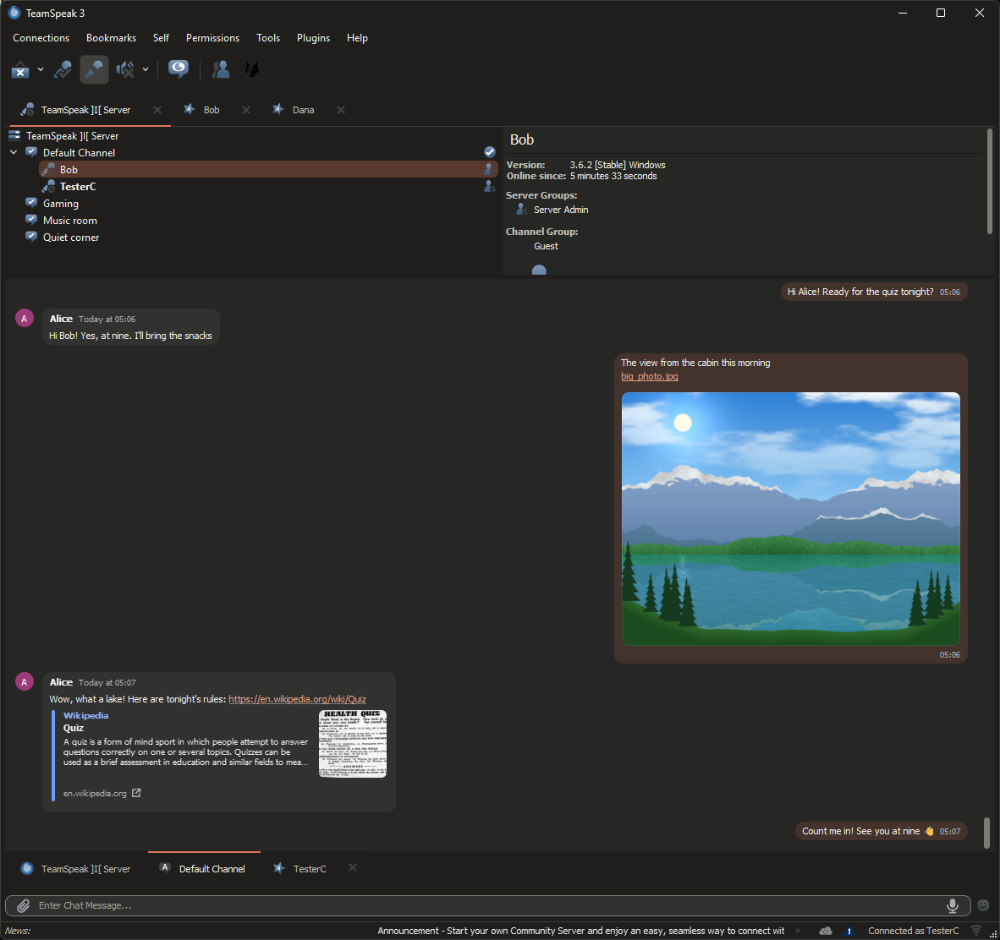

## ⬇️ [Download TSMedia-2.7.0.ts3_plugin](https://github.com/Metihttp/Teamspeak_Media_chat/releases/download/v2.7.0/TSMedia-2.7.0.ts3_plugin)

**For TeamSpeak 3, this is the only file you need.** Double-click it to install. The other files further down are used by automatic updates; ignore them.

---

**TS Media chat 2.7.0** brings a dark mode for all of TeamSpeak, bold, italic, underline and spoilers for your own text, link previews only from your friends and a new Settings window.

### Highlights

- **Dark mode.** One switch in Settings turns the whole TeamSpeak window into a warm, modern dark theme; turn it off and your own style is back exactly.
- **Format your text.** Select text and right-click for Bold, Italic, Underline or Spoiler; people with TS Media see text spoilers as bars until they click.
- **Only from friends.** Link previews can load by themselves only for your TeamSpeak friends, so a stranger's link can't grab your IP address.
- **A new Settings window.** Pages in a sidebar, cards and switches, sharp at 150% and 200% scaling, in your skin's colors and easy to use with the keyboard.
- **Zoom kept, 4K fixed.** Your Ctrl + mouse wheel zoom is kept for every chat, and the reply bar's text is no longer tiny on 4K screens.
- **Colors for dark themes.** TS Media's own chat lines read well on any custom dark theme, and you can pick their color in Settings.
- **The chat keeps its place.** After Options → Addons → Reload the chat stays at its end, or on the message you were reading, at any scaling.

### What's new

- **Dark mode** (*Settings → Chat → Appearance*, *Plugins → TS Media chat → Turn on dark mode*, or a hotkey): the main window with its menus and tool bar, the channel tree, the chat tabs and the chat, the info panel, tool tips, scroll bars, TeamSpeak's dialogs (Options, Connect, Bookmarks, Identities, Permissions, the file browser, …), the title bars and every TS Media window turn into a warm dark theme at once, no restart. Lines already in the chat are made readable. It doesn't change your choice in *Tools → Options → Design*: turning it off, or turning TS Media off, brings back exactly the style you use there. TS Media remembers it, so TeamSpeak starts dark.
- **Formatting.** Select text in the chat input and right-click it: **Bold**, **Italic**, **Underline** and **Spoiler** come right after *Select All*. Bold, italic and underline are TeamSpeak's own formatting, so everyone sees them; an entry with a tick removes it again, and one Ctrl+Z undoes one entry. Alt+Shift+S marks a spoiler from the keyboard.
- **Text spoilers.** Spoiler text is sent as `[spoiler]the text[/spoiler]`. People with TS Media 2.7 see each word as a bar until they click it (or open the message's menu → **Reveal spoiler** with the keyboard). A link inside a hidden spoiler gets no preview and loads nothing, and reply quotes and copies say *(spoiler)*.
- **Only from friends** (*Settings → Link previews*, off by default): with *Load link previews automatically* on, a link loads from its website by itself only when its sender is marked **Friend** in your TeamSpeak contacts; everyone else's links show **Load preview**. Links from people you marked **Blocked** never load by themselves, with or without it. Previews made by the sender (they come from your TeamSpeak server and never connect your PC to the website) and your own links are not affected.
- **The new Settings window:** *Chat*, *Emoji & GIFs*, *Sending*, *Receiving & playback*, *Link previews*, *Privacy*, *Servers* and *About & updates* in a sidebar, each a column of titled cards with switches. Every size follows TeamSpeak's font and every color your skin, also a custom dark one. Every option has an access key, Ctrl+Tab switches pages, and closing the window with unsaved changes asks *Save your changes?*.
- **Your chat zoom is kept.** Ctrl + mouse wheel in any chat sets one text size for every chat, kept when TeamSpeak restarts and after a Reload. *Settings → Chat → Text size and colors* shows it in percent with −, + and **Reset**.
- **Color of messages from TS Media** (*Settings → Chat → Text size and colors*): *Automatic*, *Blue*, *Teal*, *Green*, *Orange*, *Pink* or *Same as the chat text*, each made light or dark enough for your chat's background.

### Changed

- *Show spoilers without blurring or hiding* (*Settings → Receiving & playback → Spoilers*) covers text spoilers too.
- Ctrl + mouse wheel zooms every chat, not only the one under the pointer: the others follow a moment after you stop.
- The link in TS Media's own lines (the update notice, the chat proxy's notices) is drawn in the line's color, so it reads on dark chats too.
- Settings moved with the new window: *General* is now the *Chat* page, its Emoji, Media cache and Diagnostic info went to *Emoji & GIFs*, *Receiving & playback* and *About & updates*, and *Privacy & updates* became *Privacy*, *Link previews* and *About & updates*. No setting, default or `settings.ini` key changed.

### Fixed

- After **Options → Addons → Reload**, or turning TS Media off and on, a chat at its end comes back at its end and a chat you scrolled up shows the same message in the same place, with any Windows scaling.
- The reply bar above the chat input, the *View N replies* list, the voice message strip and the music bar were tiny at 150% and 200% display scaling; they now grow with Windows scaling and the chat's zoom.
- TS Media's chat lines were hard to read on custom dark themes: their colors now come from the chat's real background, and every line reads at 4.5:1 or better.

### Good to know

- **A text spoiler is no secret.** Everyone without TS Media 2.7 (older versions, TeamSpeak alone, ServerQuery, chat logs) reads the tags and the text: [what a text spoiler hides and doesn't](https://github.com/Metihttp/Teamspeak_Media_chat/blob/v2.7.0/docs/PRIVACY-SECURITY.md#text-spoilers).
- **Only from friends reads your TeamSpeak contacts** on this PC, read-only: only the Friend and Blocked marks and the unique IDs, in memory. Nothing is sent, logged or saved: [what is read](https://github.com/Metihttp/Teamspeak_Media_chat/blob/v2.7.0/docs/PRIVACY-SECURITY.md#only-from-friends-and-blocked-contacts).
- **Dark mode and TeamSpeak's own skins** are two different things: you can use either, or both. Dark mode changes no Windows setting and nothing outside TeamSpeak: [dark mode and your skin](https://github.com/Metihttp/Teamspeak_Media_chat/blob/v2.7.0/docs/FAQ.md#dark-mode-and-my-own-teamspeak-skin).

### Install or update

**On 2.2.1 or later (2.2.1, 2.3.x, 2.4.0, 2.5.0 or 2.6.0):** it updates itself. Wait for the update offer, or use **Check for updates…** in the plugin menu. Your settings, cache and GIFs are kept. On 2.2.0 it updates to 2.2.1 first, then to 2.7.0.

**On 2.1 or older, or new here?** Close TeamSpeak, double-click the file above, then type `/tsmedia` in the chat.

### Known issues

- The 32-bit DLL is untested on a real 32-bit client, and it has no YouTube player (Play opens your browser).
- In dark mode, web pages inside TeamSpeak (the Addons browser, myTeamSpeak), the YouTube player's page and a few names TeamSpeak colors in the channel tree (friends, blocked people, someone recording) keep their own colors: [why](https://github.com/Metihttp/Teamspeak_Media_chat/blob/v2.7.0/docs/FAQ.md#some-names-in-the-channel-tree-keep-their-colors-in-dark-mode).
- After you turn dark mode off, the bold *TS Media chat* of a line printed while it was on with *Same as the chat text* comes back in the name color; if you turn TS Media off in *Options → Addons* while dark mode is on, cards drawn in dark mode can stay dark until TS Media draws them again.
- With *Use Windows proxy settings*, a Windows setup script that answers with a SOCKS proxy can still send the update check directly, and the YouTube player through SOCKS with names looked up on your PC; the chat proxy avoids this.
- TeamSpeak may crash or hang when it quits, with or without the plugin: [workaround](https://github.com/Metihttp/Teamspeak_Media_chat/blob/main/docs/FAQ.md#teamspeak-crashes-or-hangs-when-i-quit).

[All known issues and answers](https://github.com/Metihttp/Teamspeak_Media_chat/blob/main/docs/FAQ.md)

SHA-256 of TSMedia-2.7.0.ts3_plugin: `024DE68821DAB3079FF6981185454ACE941EB26BAED9C6A7E68BED18E829C12E` · [Full changelog](https://github.com/Metihttp/Teamspeak_Media_chat/blob/v2.7.0/CHANGELOG.md) · [Compare v2.6.0...v2.7.0](https://github.com/Metihttp/Teamspeak_Media_chat/compare/v2.6.0...v2.7.0)
